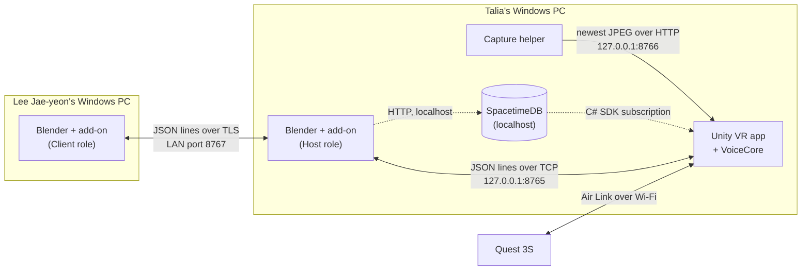

# Collaborative Blender VR product and team build plan

We are building a new Windows application that lets people create and edit a real Blender project in virtual reality. A Quest 3S connects wirelessly to Talia's PC. The user chooses where a virtual worktable goes, sees Blender objects on it, and edits them with controllers, a hand-held or placed menu, exact numeric values, CAD sketch constraints and voice commands. A separate panel shows the live Blender window and can be hidden or shown.

Edits made in VR must update the native Blender project. Changes made in Blender must appear automatically in VR. A second person will edit the same session from Blender on Lee Jae-yeon's Windows computer. The app will explain who is editing, protect conflicting objects and preserve native Undo, Redo, Save and reopen. Voice will ask for missing information and remember the rest of the command.

This is a fresh build. The VR application, the Blender add-on (host and client roles), the capture helper, the editing interface and the voice behavior will be written for this project. Unity, Blender and appropriately licensed third-party libraries are dependencies. No product feature or acceptance test is assumed complete.

This document is the team's complete working plan: product behavior, hardware and Wi-Fi setup, ownership, phased checklists, integration rules, acceptance, progress tracking, sponsor choices and the full feature catalog. Every phase includes all four people. Start with the core phases P0 to P6; later phases retain the broader product scope.

## Team responsibilities

| Person and computer | What this person builds | What the team receives |
| --- | --- | --- |
| Waaberi — Linux | Blender add-on Host role: session server and Blender command system; edit permissions; voice recognition behavior, missing-input memory and spoken prompts. | Documented messages, tested backend commands and voice components that Jihyeon can connect to the UI. |
| Lee Jae-yeon — Windows | Blender-window capture helper; Python CAD adapter; the add-on's Client role for the second computer; test tools and release packaging. | Working Windows helpers, a usable remote Blender client, clear failure reports and an installable package. |
| Jihyeon — Mac | New Unity app; VR room/table; controller input; held/pinned menu; settings; all visual feedback; microphone/voice UI adapter. | A Windows VR build that can be tested on Talia's PC, with desktop simulation for independent development. |
| Talia — Windows and Quest | Mechanical reference models, useful modeling steps, CAD dimensions, physical VR tests, native validation and demo. | Expected engineering results, precise bug reports, phase acceptance evidence and the final demonstration. |

Waaberi coordinates software merges. Jihyeon owns shared Unity scenes and settings. Lee Jae-yeon operates Windows packaging and the second Blender client. Talia owns the primary headset and final workflow acceptance. Each person reviews changes in their own files.

## Deadline and honest scope

Delivery target: Saturday October 24, 2026 at 11 p.m. Pacific, which is Sunday October 25 at 2 a.m. Toronto. Target feature freeze is Saturday 7 p.m. Pacific / 10 p.m. Toronto. Reserve the last 90–120 minutes of integrated testing for the real two-person workflow, recovery and capture, plus a delivery buffer.

The complete scope is not a credible guaranteed weekend delivery from a fresh build. Wireless readiness, native synchronization, constrained CAD, reliable edit protection, voice and remote Blender are each significant risks. Keep producing working versions and report missing mandatory tests. A useful earlier phase is progress; it is not completion of P6. Waaberi and Talia reported at least 25 hours each; the other two availability totals are unconfirmed.

The team aims to finish everything by Saturday 11 p.m. Pacific, leaving time to sleep and prepare the pitch. These checkpoints keep that possible (Pacific time; the team can adjust them):

| Checkpoint | Target |
| --- | --- |
| P0 passed | Friday 10 p.m., then sleep |
| P1 passed; SpacetimeDB spike | Saturday 11 a.m. |
| P2 passed | Saturday 1 p.m. |
| P3A passed | Saturday 3 p.m. |
| P3B, P3C, P4 and P5 | Saturday 7 p.m. feature freeze |
| Full rehearsal on the release build (P6) | Saturday 9–11 p.m. |

If a checkpoint slips by more than an hour, cut scope in this order instead of cutting sleep: first the P6 finishing extras (materials, UV, render, export), then P3C, then whichever of P4 and P5 is further behind. Record each cut as a known limit for the pitch.

## Architecture

The final native document lives in Blender on Talia's PC. Our Blender add-on runs inside that Blender in **Host** role and is the only authority. Every edit is a request that the host validates, applies in Blender and confirms, whether it comes from VR or from the second computer. Unity renders the VR view of the scene. The flat Blender screen is a separate image stream. Air Link provides PC VR, but we have to build the scene synchronization ourselves. The Quest needs no standalone Android build.

| Component | Runs on | Owner | Code |
| --- | --- | --- | --- |
| Blender add-on, Host role: session server, command dispatch, scene sync, permissions | Talia PC, inside Blender | Waaberi | `blender_addon/spatial_modeling/` |
| Blender add-on, Client role: joins a host, mirrors its scene, sends edits | Lee Jae-yeon PC, inside Blender | Lee Jae-yeon | `blender_addon/spatial_modeling/remote_client/` |
| CAD adapter used by the host | Talia PC, inside Blender | Lee Jae-yeon | `blender_addon/spatial_modeling/sketch/` |
| Unity VR app | Talia PC; Mac for simulated development | Jihyeon | `app/` |
| VoiceCore: voice command parsing and missing-information memory | Talia PC, inside the Unity app; Linux for tests | Waaberi | `voice/VoiceCore/` |
| Capture helper | Talia PC | Lee Jae-yeon | `desktop-capture/` |

The wire format for all three connections is in [contracts/README.md](contracts/README.md). An interface change updates the sender, the receiver and that file in the same PR.

### Architecture decisions

1. **The add-on is the host; there is no separate host service.** Blender has to apply every edit on its own main thread anyway. A separate process would add a network hop, a process lifecycle and launcher work without adding any capability.
2. **One add-on, two roles.** The same add-on is installed on both Windows PCs, and the role is chosen in its preferences. Host and Client share the protocol code, so they can't drift apart.
3. **One wire format: one JSON object per line over TCP.** Inside Blender this needs only Python's standard library; Unity uses `TcpClient`. Nothing has to be installed into Blender. The Unity port listens on localhost only. The LAN port uses TLS with the session token as a pre-shared key (Python 3.13's `SSLContext.set_psk_*_callback`), so no certificates are needed. This works in Blender 5.2.2's own Python on Linux (TLS 1.3, OpenSSL 3.5.6; P1-W-3); Windows is still to be confirmed. If it fails, the LAN port runs without TLS on an isolated network route, with the token in `hello`.
4. **Blender's main thread does all Blender work.** Sockets run on a background thread. Received messages go into a queue, and a `bpy.app.timers` callback drains it on the main thread. Received data is never executed as Python. Timers don't run while Blender is blocked, for example during a render, so messages wait until it finishes. Undo/Redo work from a timer, but operators called from a timer don't record their own undo step, so every committed edit must end with `bpy.ops.ed.undo_push(message=...)`. Otherwise it merges into the previous step and one Undo reverts both (tested in Blender 5.2.2).
5. **The wire uses Blender's coordinates and units:** right-handed, Z up, meters and radians. Unity converts in exactly one place (P2-W-2).
6. **Stable object IDs are UUIDs stored in a custom property on each object.** They survive renames, Undo and save/reopen. Duplicating an object copies the property, so the host checks for repeated IDs and gives the copy a new one.
7. **The Blender screen is fetched on request, not pushed.** The capture helper keeps only the newest frame and serves it on localhost. Unity requests it at a modest rate, so old frames can't pile up.
8. **VoiceCore is a plain C# library outside the Unity project.** Unity loads it as a local package, and its assembly definition forbids Unity references. Waaberi builds and tests it on Linux. Jihyeon's VoiceUiAdapter feeds it microphone audio, selection and pointer targets. Recognition uses Vosk with a restricted command grammar first, because Vosk also runs on Linux and Mac for development. Unity's Windows speech recognition is the fallback.
9. **SpacetimeDB (sponsor) holds shared session state (the spike passed, #16); it is never in the geometry path.** Unity has an official C# SDK with live subscriptions. Blender has no maintained Python SDK (it has been on hiatus since May 2024), and the PostgreSQL wire protocol has no live subscriptions. So Blender uses SpacetimeDB only through its HTTP API with the standard library, from a background thread: it calls reducers and reads small tables. That makes SpacetimeDB a good fit for participants and presence, object leases, and the activity and receipt log (P3B, P5). It is a poor fit for scene data and native commands, which stay on the direct host connection. See [Sponsor choices](#sponsor-choices-and-optional-services) for the spike and its pass criteria. Blender decides leases in memory and copies them to SpacetimeDB, so it keeps working if no server is running.
10. **CAD sketches use CAD Sketcher inside the host Blender**, wrapped by Lee Jae-yeon's adapter, and only if the P0 compatibility check passes.

| Port | Listens on | Used by |
| --- | --- | --- |
| 8765 | 127.0.0.1 only | Unity app ↔ host add-on |
| 8766 | 127.0.0.1 only | Capture helper → Unity app |
| 8767 | All the host PC's interfaces, or one chosen address; only while enabled in the add-on preferences | Client-role add-on ↔ host add-on |

| Device | Applications to run |
| --- | --- |
| Talia Windows PC | Blender with the add-on in Host role; Unity Windows app; capture helper; Meta Horizon Link/OpenXR. |
| Quest 3S | Air Link session with Touch Plus controllers and routed microphone/output. |
| Lee Jae-yeon Windows PC | Blender with the add-on in Client role; Windows build and test tools. |
| Waaberi Linux PC | Add-on and VoiceCore development and tests. The final demo must not depend on this laptop. |
| Jihyeon Mac | Unity Editor with the XR Device Simulator and simulated host, capture and speech. Physical Link tests run on Windows. |

Meta documents the [Windows Link/OpenXR development path](https://developers.meta.com/vr/documentation/unity/unity-link/). Mac/Linux development checks do not replace Windows native-plugin, microphone or Quest tests.

## Independent work and GitHub integration

First agree on message examples and file ownership. Each person develops against sample messages while another component is unfinished. Use small codex/<person>-<phase>-<slice> branches. Merge working increments approximately every 60–90 minutes, not one large branch per person at the end. The interval is a coordination target, not an estimate for completing a whole phase.

Keep unfinished features disabled behind feature flags. After each merge, run the changed component and a short test of every already-working feature. At each phase gate, run the actual target setup, record the commit/build and tag the known good version. Fix or revert a small change that breaks the previous product. Preserve the last good package.

| Owner | Exclusive code or document area |
| --- | --- |
| Waaberi | contracts/; blender_addon/spatial_modeling/ except sketch/ and remote_client/; voice/; spacetime/; tests/backend/; tests/voice/ |
| Lee Jae-yeon | desktop-capture/; blender_addon/spatial_modeling/sketch/; blender_addon/spatial_modeling/remote_client/; tests/protocol/; tests/security/; scripts/windows-release/ |
| Jihyeon | app/ |
| Talia (you) | samples/mechanical/; acceptance/native-reference/; docs/product-workflow/; docs/demo/ |

Waaberi owns root Git/CI configuration and shared backend dispatch. Jihyeon owns VoiceUiAdapter.cs in app/; Waaberi owns VoiceCore in voice/VoiceCore/. When Unity first imports VoiceCore it creates .meta files in voice/VoiceCore/; Jihyeon may commit those. Lee Jae-yeon owns only the named sketch and remote_client Python subfolders inside the add-on. Ask the owner or explicitly transfer a file before editing it. Commit each Unity asset with its .meta and preserve GUIDs. One author edits each binary .blend reference file. Use separate local clones, preferably outside active cloud-sync folders. Keep machine paths, tokens, generated Unity folders and build outputs out of Git. Pin dependency versions and use consistent filename case for Linux.

Every hand-off includes the commit/build ID, what changed, how to run it, expected output, actual test result and known failures. Interface changes update sender, receiver and sample messages together. Mocks help development but never count as native or physical acceptance.

## Phase overview

| Phase | Working product after the phase |
| --- | --- |
| P0 | A new project repository, Unity app shell and Blender add-on skeleton can be started with agreed messages and tool versions. |
| P1 | Launch the Windows app, enter VR over Wi-Fi, and show or hide a live Blender window inside the app. |
| P2 | The user chooses where the virtual worktable goes. Real Blender objects appear there and update automatically. |
| P3A | Use a hand-held or placed menu to create and transform real Blender objects, with handedness settings. |
| P3B | Choose temporary exclusive editing or shared editing. Inspection stays free; real conflicting changes are stopped. |
| P3C | Create a real editable planar CAD sketch. Dimensions and geometric constraints change the solved geometry. |
| P4 | Say a supported command, hear a useful question when information is missing, and complete it without repeating the whole command. |
| P5 | A second person edits in Blender on Lee Jae-yeon PC. Changes reach main Blender and VR, and accepted changes return to both Blender clients. |
| P6 | One reproducible package demonstrates every required phase and preserves the original native finishing/output requirements. |

Preparation can overlap. Test remote network reachability in P0, a remote read-only Blender snapshot in P2, and one actual remote Blender edit in P3A. P5 expands this already-integrated path. A CAD blocker does not prevent independent voice or remote-client development, but all required phases must pass before P6 is complete.

## Progress and the one headset

Status is tracked on the project board with GitHub's standard columns: Backlog, Ready, In progress, In review and Done. The "Status:" lines in the checklists below are superseded by the board. Close a task only when its step works; close a phase's team-test issue only after its real team test. Record evidence and blockers rather than estimating an arbitrary percentage. All product tests start pending in this fresh-build plan.

Keep the Quest on Talia's PC. Reserve an initial 45–60-minute wireless/app test, then focused 20–30-minute ready-to-test slots with a named behavior and exact build. Others continue independently. Prefer builds on Lee Jae-yeon's PC if capable; otherwise book Talia's machine separately so builds or automation do not interrupt a native/headset test.

Each issue on the [project board](https://github.com/users/waaberi/projects/3) is one unit of work: the task IDs one person can finish in one branch, listed as checkboxes, with the owner as assignee and Phase, Priority and Task ID fields. Work stays in separate issues when others are blocked on part of it or it spans owners or subsystems. Each phase's physical checks are checkboxes in its team-test issue. Issues for a phase are created when its work starts. Short IDs M1 and M2 remain stable tracking codes for Lee Jae-yeon and Jihyeon respectively.

Reserve roughly 4–7 joint hours for hardware and integration across the weekend, including the final 90–120-minute rehearsal. Aim for ready-to-test slots about every two hours, with one wearer and one desktop observer. Use an owner/start/end queue for the host PC. Keep the final 4–6 hours focused on integration and release; these reserves overlap the testing windows and must not be added twice.

## P0 Shared setup and early risk checks

Working result: A new project repository, Unity app shell and Blender add-on skeleton can be started with agreed messages and tool versions.

Completion depends on: the new project setup and recorded risk checks. Independent preparation may start earlier.

| Person | Task in plain English | Hand over |
| --- | --- | --- |
| Waaberi | Define messages and create the Blender add-on skeleton. | Schema examples and a working ping. |
| Lee Jae-yeon | Check network and CAD dependencies on Windows. | Setup notes and compatibility result. |
| Jihyeon | Create Unity/OpenXR project and Windows app shell. | A build that both Windows PCs can start. |
| Talia (you) | Prepare the model and check the Quest setup. | Reference dimensions and a hardware result. |

### Product behavior and engineering rules

The repository, CI and a Blender add-on skeleton already exist. Build the minimal first working path: the Windows app shell, and a ping between the app and the add-on over the host connection. Pin compatible Unity, Blender, OpenXR, Python and library versions before feature branches diverge. Initial target versions are Unity 6000.6.5f1 and Blender 5.2.2; verify availability and compatibility in this new project, then lock the agreed versions. CAD and speech dependency checks may report blockers without preventing independent app setup.

Talia and anyone new to Unity spend 60–90 minutes opening the new project, finding scenes and assets, using Game/Scene views and the Inspector, reading console errors, and running/stopping the app. Jihyeon shows the new OpenXR input actions. Budget roughly 1–2 hours for initial learning and another hour of short phase exercises; count this within each person's available time.

Agree on a request envelope before parallel implementation: contract version, session ID, host/source epoch, document ID/open epoch, authenticated actor, unique request ID, base revision, stable target ID/generation, operation, bounded arguments and lease token. Record units and pending/applied/rejected/unknown outcomes. Implement and validate the matching schema at both ends. The framing and base envelope are already in [contracts/README.md](contracts/README.md); add the command fields there along with the P0-W-1 examples. Native Blender remains the authority for the actual committed result.

### Risk checks and response

Check Mac compilation and Windows plugins immediately; Jihyeon uses mocks on Mac and sends an early Windows build. Talia and Jihyeon test Link/OpenXR/controllers before deep UI work. Lee Jae-yeon runs a 60–90-minute solver solve/save/reopen trial and a clean Windows package trial. Waaberi proves native revision/history/receipt behavior early. Talia supplies exact unit and output references. Simplify visual styling if binocular readability or frame time fails. Record a blocker and reforecast from actual results instead of treating an unmeasured estimate as guaranteed.

If a focused 90-minute hardware/native-edit session cannot produce a physical edit, identify whether the blocker is Link, OpenXR, input focus, microphone or the new native bridge. Continue independent work while that owner resolves it. After feature freeze, repair required failures; preserve the last matching working package. New binaries need their own relevant hardware evidence.

### Waaberi checklist

Status: NOT STARTED | Build or commit: ______ | Evidence: ______ | Blocker and owner: ______

- [ ] **P0-W-1** Write one example for each message: frame, scene, command, result, lock, voice and sketch. Include object IDs, units and document revision.

- [ ] **P0-W-2** Give Jihyeon a fake server and Lee Jae-yeon a fake client. Fake means test data only.

- [ ] **P0-W-3** Build out the VoiceCore library in voice/VoiceCore/ with tests in tests/voice/ that run on Linux. Define the recognizer interface and try Vosk with a restricted command grammar. Do not tie command logic to Unity or a Windows-only API.

- [ ] **P0-W-4** Write the JSON message schemas. Add the localhost server (port 8765) to the add-on skeleton and implement a ping without changing scene data. Check that the add-on still registers and unregisters cleanly.

### Lee Jae yeon checklist

Status: NOT STARTED | Build or commit: ______ | Evidence: ______ | Blocker and owner: ______

- [ ] **P0-M1-1** Install/open the agreed Blender version on your PC. Help run the new Windows app shell when Jihyeon provides it. Write down each dependency and error.

- [ ] **P0-M1-2** Test whether your PC can reach Talia PC on the event network. Record pass or fail.

- [ ] **P0-M1-3** On a COPY of a .blend file, check whether CAD Sketcher and its solver work with the pinned Blender. Save, close and reopen a dimensioned sketch. Limit this first check to 60-90 minutes.

### Jihyeon checklist

Status: NOT STARTED | Build or commit: ______ | Evidence: ______ | Blocker and owner: ______

- [ ] **P0-M2-1** Create a new Unity project in app/ with OpenXR, the XR Interaction Toolkit and Newtonsoft JSON, and add voice/VoiceCore as a local package. Pin versions with the team. On Mac, use simulated headset, capture and speech responses where needed.

- [ ] **P0-M2-2** Show a cube using the fake scene message. Show an error message when the fake connection stops.

- [ ] **P0-M2-3** Build the first Windows app shell and send Talia and Lee Jae-yeon exact build/run instructions. Keep scene and package edits in your owned files.

### Talia checklist

Status: NOT STARTED | Build or commit: ______ | Evidence: ______ | Blocker and owner: ______

- [ ] **P0-T-1** Create a small test .blend with a cube, cylinder and known millimeter dimensions.

- [ ] **P0-T-2** Record your GPU, Link readiness and the available event Wi-Fi/Ethernet connection. Test device reachability with Lee Jae-yeon.

- [ ] **P0-T-3** Write the demo steps and expected CAD dimensions. Keep the Quest on your PC.

### Team test to pass this phase

Create a new repository and record tool versions. Build/run the new Windows app shell. Load the new Blender add-on and complete a ping handshake. Record network reachability and the CAD compatibility check, including blockers. Agree on frame, scene, command, lock, voice and sketch examples. A mock response is not native acceptance.

- [ ] Test this phase on real devices and rerun the earlier working phases.
- [ ] Record build, results and failures; tag the working version after tests pass.

## P1 Windows app wireless VR and Blender screen

Working result: Launch the Windows app, enter VR over Wi-Fi, and show or hide a live Blender window inside the app.

Completion depends on: P0. Independent preparation may start earlier.

| Person | Task in plain English | Hand over |
| --- | --- | --- |
| Waaberi | Build the local host connection and launcher contract. | Blender and the app report connection state. |
| Lee Jae-yeon | Capture the selected Blender window. | A live frame stream and capture errors. |
| Jihyeon | Show the frame stream on a toggled VR panel. | A Windows VR app with Show/Hide Blender. |
| Talia (you) | Run the wireless screen trial. | Actual Quest and screen-toggle evidence. |

### Product behavior and engineering rules

P1 shows a live selected Blender window inside our app and toggles it there. This first panel is view-only; arbitrary mouse/keyboard interaction with every Blender editor is additional work. VR menu commands use the native command path. A Meta system desktop window alone does not pass P1.

Lee Jae-yeon supplies bounded latest-frame data: window identity, frame ID/time, dimensions and availability. Jihyeon displays it. Start with a measured modest update rate and no growing stale-frame queue. Closed/minimized/unsupported capture shows an unavailable state. [Windows capture APIs](https://learn.microsoft.com/en-us/windows/apps/develop/media-authoring-processing/screen-capture) support application-window capture; our chosen helper still needs compatibility/performance testing.

### Short learning exercise

Talia starts the new app, finds the controller action and toggles the Blender panel. Jihyeon explains any console error.

### Wi Fi setup checklist

- [ ] Verify Talia GPU/Windows/driver compatibility with the installed Meta Link version. Complete normal Link installation/sign-in if needed.
- [ ] Use approved Ethernet for the host PC if available. Connect Quest to suitable 5 GHz Wi-Fi. Wired PC and wireless Quest can communicate only if the event network permits it.
- [ ] Ask event network staff which connection permits PC-to-headset and PC-to-PC traffic. Same SSID is not proof of reachability; wired/wireless VLANs may differ.
- [ ] In Quest Link/Air Link settings choose the wireless PC connection. Select Talia PC, verify the pairing code on both devices, and connect. Menu labels vary by installed version; use Meta's current guide linked below.
- [ ] Set Meta Horizon Link as the active OpenXR runtime for this test. Confirm the Unity project uses its pinned compatible provider/settings.
- [ ] Run a known working PC VR scene. Verify tracking and both controllers before diagnosing Blender data flow.
- [ ] Open the native reference project with the add-on in Host role. Start the capture helper and the Unity Windows EXE through the documented launcher.
- [ ] Select Blender's window for capture. Use Show Blender / Hide Blender inside our app. Verify a changing live image, not just a Meta system desktop screen.
- [ ] In Phase 2 choose Place Table. Edit an object in main Blender and see automatic 3D updates on the table.
- [ ] Select/test the routed Quest microphone and output device. Check actual recording and audible prompt; do not mistake the laptop mic for the Quest mic.

### If Wi Fi pairing or performance fails

Separate Air Link failure from the add-on's localhost connection and the LAN session connection. Ethernet can improve the PC side but does not bypass client isolation, separate VLANs or congestion on the headset's access point. Ask staff for an approved reachable network/dedicated access point or permission to use a borrowed private/travel router. A Windows hotspot is not an assumed equivalent. Do not disable firewalls, alter venue policy or configure port forwarding as a blind fix.

USB Link can keep development moving if Wi-Fi fails. It does not pass the requested wireless gate. Network changes must follow venue policy; no purchase or paid fallback is assumed.

Meta recommends a wired PC connection to the access point/router, suitable 5 GHz headset Wi-Fi and nearby line of sight. Event Wi-Fi may still isolate devices or be congested. [Meta Air Link guidance](https://communityforums.atmeta.com/discussions/OtherTroubleshooting/3s-air-link-not-working/1345035/replies/1345046).

### Waaberi checklist

Status: NOT STARTED | Build or commit: ______ | Evidence: ______ | Blocker and owner: ______

- [ ] **P1-W-1** Build the add-on's localhost server for the Unity app (port 8765). Add connected, disconnected and wrong-document messages. Document how Blender, the capture helper and the app are started or attached.

- [ ] **P1-W-2** Review the frame message from Lee Jae-yeon: frame number, time, window identity, image size and capture status.

- [ ] **P1-W-3** Prepare the add-on's LAN listener for Client-role peers (port 8767): TLS with the session token as a pre-shared key. Confirm Blender's bundled Python supports this; otherwise fall back to token authentication on an isolated route. Never expose port 8765 to the LAN.

- [ ] **P1-W-4** Build a bounded message reader and the server lifecycle: start when the add-on is enabled, stop when it is disabled or another file loads. Keep Blender data access on its permitted execution path; reject malformed messages and never execute arbitrary received Python.

### Lee Jae yeon checklist

Status: NOT STARTED | Build or commit: ______ | Evidence: ______ | Blocker and owner: ______

- [ ] **P1-M1-1** Build a Windows helper that captures only the Blender window selected by the user. First make one real frame, then repeated frames.

- [ ] **P1-M1-2** Serve only the newest frame on 127.0.0.1:8766 as described in contracts/README.md. Unity requests frames, so no queue of old images can build up.

- [ ] **P1-M1-3** Show a clear capture error if Blender is closed, minimized or cannot be captured. Test resizing and window focus. Hand Jihyeon real frame samples.

- [ ] **P1-M1-4** Write the Windows launcher and first connection diagnostic. Record dependency installation and how to start or attach Blender without closing unsaved work.

### Jihyeon checklist

Status: NOT STARTED | Build or commit: ______ | Evidence: ______ | Blocker and owner: ______

- [ ] **P1-M2-1** Build the Windows app with a VR room and a flat screen panel.

- [ ] **P1-M2-2** Read Lee Jae-yeon frame messages and show the latest Blender image on the panel.

- [ ] **P1-M2-3** Add a Show Blender / Hide Blender button and controller shortcut. Show connection/capture errors. Test on Talia PC.

### Talia checklist

Status: NOT STARTED | Build or commit: ______ | Evidence: ______ | Blocker and owner: ______

- [ ] **P1-T-1** Pair the Quest with your PC using Air Link and launch the app. Use the Wi-Fi guide.

- [ ] **P1-T-2** Change the Blender view on your PC. Confirm that the in-app screen updates and can be hidden/reopened.

- [ ] **P1-T-3** Read text in both eyes. Record lag, capture failures and exact build ID. A wired-only pass is not the wireless pass.

### Team test to pass this phase

Run the Windows EXE over Air Link for five minutes. Change the Blender viewport and see the live screen update. Toggle that screen off/on ten times with the app control. Close/reopen Blender and show an honest unavailable/reconnect state. A Meta system desktop window alone does not pass the in-app screen requirement.

- [ ] **RC13** Run the Windows app through actual Air Link Wi-Fi. Show and hide the selected live Blender window inside the app.

- [ ] Test this phase on real devices and rerun the earlier working phases.
- [ ] Record build, results and failures; tag the working version after tests pass.

## P2 Choose a worktable and see live 3D Blender changes

Working result: The user chooses where the virtual worktable goes. Real Blender objects appear there and update automatically.

Completion depends on: P1. Independent preparation may start earlier.

| Person | Task in plain English | Hand over |
| --- | --- | --- |
| Waaberi | Send native geometry, IDs, units and revisions. | Automatic scene updates and reconnect snapshot. |
| Lee Jae-yeon | Check scene data and load a remote read-only copy. | A second Blender showing host scene data. |
| Jihyeon | Build scene rendering and Place Table controls. | User-placed table with live objects. |
| Talia (you) | Measure scale and test inspection movement. | Native dimensions remain correct. |

### Product behavior and engineering rules

Show a table preview and require Place Table before displaying the model. Define axes, handedness and meter/millimeter conversion once. New snapshots do not move the user's table. After tracking-space reset/recenter, confirm or reset placement rather than assuming the old room pose remains correct.

Move Table / Inspect affects only the local display transform: no native coordinate, dimension or history change and no editing lock. Move/Rotate/Scale Object changes the model and requires permission. Walking, looking and selection are inspection. Make the two kinds of movement clear in the menu.

### Short learning exercise

Talia moves the table, then moves one Blender object. Everyone explains why only the second action changes the native project.

### Waaberi checklist

Status: NOT STARTED | Build or commit: ______ | Evidence: ______ | Blocker and owner: ______

- [ ] **P2-W-1** Send native scene snapshots and updates with stable object IDs, document ID, revision and unit information.

- [ ] **P2-W-2** Define the Blender-to-Unity coordinate conversion once. Include axes, handedness and meter/millimeter scale.

- [ ] **P2-W-3** Give the future remote Blender client the same read-only snapshot. Do not accept edits from it yet.

- [ ] **P2-W-4** Implement mesh, transform, hierarchy and basic material serialization. Send stable IDs and scene revisions; batch changes and send a fresh snapshot after reconnect.

- [ ] **P2-W-5** Implement native change observation and main-thread dispatch. Test that host changes reach Unity without manual export or refresh and without an update loop.

### Lee Jae yeon checklist

Status: NOT STARTED | Build or commit: ______ | Evidence: ______ | Blocker and owner: ______

- [ ] **P2-M1-1** Write a Python check that reads a scene snapshot and checks object ID, position and units.

- [ ] **P2-M1-2** Enable the add-on in Client role on your PC. Load the host snapshot into a separate session file for an early read-only test.

- [ ] **P2-M1-3** Check that a missing connection cannot silently show old data as current.

### Jihyeon checklist

Status: NOT STARTED | Build or commit: ______ | Evidence: ______ | Blocker and owner: ______

- [ ] **P2-M2-1** Show a table preview. Let the user point, move/rotate the preview, and press Place Table before showing the model.

- [ ] **P2-M2-2** Put imported objects below one table/display parent. Keep this display transform separate from the native model transform.

- [ ] **P2-M2-3** Add Move Table / Recenter / Reset View. Keep the chosen placement while new scene updates arrive.

- [ ] **P2-M2-4** Build the Unity scene receiver, object creation/removal, mesh rendering and selection colliders. Reuse stable IDs across updates and keep display scaling outside native model data.

### Talia checklist

Status: NOT STARTED | Build or commit: ______ | Evidence: ______ | Blocker and owner: ______

- [ ] **P2-T-1** Choose a comfortable table height, distance and size in the headset.

- [ ] **P2-T-2** Move, add and delete objects directly in Blender. Check that VR changes automatically.

- [ ] **P2-T-3** Move/rotate/zoom the TABLE for inspection. Check that native object dimensions and Undo history stay unchanged. Test recenter and reconnect.

### Team test to pass this phase

Place the table at two different positions. Move/add/delete an object directly in host Blender and see it on the table without refresh. Reposition or zoom the table without changing native dimensions or Blender history. Reconnect and receive a fresh complete scene. Lee Jae-yeon also proves an early read-only second-Blender snapshot.

- [ ] **RC14** Choose the table position during setup. Verify live native objects and confirm table inspection never changes native dimensions or history.

- [ ] Test this phase on real devices and rerun the earlier working phases.
- [ ] Record build, results and failures; tag the working version after tests pass.

## P3A Hand menu settings and simple native editing

Working result: Use a hand-held or placed menu to create and transform real Blender objects, with handedness settings.

Completion depends on: P2. Independent preparation may start earlier.

| Person | Task in plain English | Hand over |
| --- | --- | --- |
| Waaberi | Build native edits, history and save commands. | Validated commands and native receipts. |
| Lee Jae-yeon | Test commands and send one remote Blender edit. | An early working remote command. |
| Jihyeon | Build held/pinned menu, handedness and numeric tools. | Useful controls in both hand modes. |
| Talia (you) | Model a small assembly and verify the result. | Geometry, Undo/Redo and reopen evidence. |

### Product behavior and engineering rules

Actions: Add Shape (cube/sphere/cylinder), Select, Move, Rotate, Scale, Delete, Undo, Redo, Sketch and Settings. Enable Sketch after P3C works. The menu can be held or pinned. Settings includes Hand (Right default / Left), Editing Mode, Move Table/Recenter, screen visibility and voice options when available. Hand preference changes pointer, menu attachment and shortcuts together and persists locally. Numeric fields show units.

### Short learning exercise

Change a number, Cancel, then Apply. Compare native units, selection, object data, mode and Undo history.

### Waaberi checklist

Status: NOT STARTED | Build or commit: ______ | Evidence: ______ | Blocker and owner: ______

- [ ] **P3A-W-1** Expose bounded add, move, rotate, scale, delete, Undo and Redo through one validated native command path.

- [ ] **P3A-W-2** Return success only after native Blender confirms the result. Reject stale targets and repeated changed requests.

- [ ] **P3A-W-3** Accept one controlled test command from Lee Jae-yeon remote Blender add-on. Keep the unfinished remote feature off in normal builds.

- [ ] **P3A-W-4** Implement the native transaction and receipt layer, shared Undo/Redo, dirty/saved state, Save/Save As and fresh reopen checks. Restore unrelated selection/context after commands where needed.

### Lee Jae yeon checklist

Status: NOT STARTED | Build or commit: ______ | Evidence: ______ | Blocker and owner: ______

- [ ] **P3A-M1-1** Test the command messages using your Python client. Check explicit degrees and millimeters/meters.

- [ ] **P3A-M1-2** Build the first remote Blender operator: Move selected object by a fixed amount. Send the request to the host, then show its accepted result.

- [ ] **P3A-M1-3** Test invalid numbers, missing targets and duplicate requests. Record whether the native document changed.

### Jihyeon checklist

Status: NOT STARTED | Build or commit: ______ | Evidence: ______ | Blocker and owner: ______

- [ ] **P3A-M2-1** Build menu buttons: Add Shape, Select, Move, Rotate, Scale, Delete, Undo, Redo and Settings. Keep the sketch entry disabled until P3C works.

- [ ] **P3A-M2-2** Let the user hold the menu or pin it in the room. Add Settings > Hand: Right / Left. Default to Right and save this preference.

- [ ] **P3A-M2-3** Show selected object, units, editable numeric fields, Apply/Cancel and errors. Distinguish Move Table from Move Object.

### Talia checklist

Status: NOT STARTED | Build or commit: ______ | Evidence: ______ | Blocker and owner: ______

- [ ] **P3A-T-1** Create a small assembly in VR with primitive shapes. Verify each change in native Blender.

- [ ] **P3A-T-2** Test both hand settings and both menu positions. Check that buttons and text are easy to use.

- [ ] **P3A-T-3** Test Undo/Redo and fresh native reopen. Check a 90-degree rotation and a 10 mm movement numerically.

### Team test to pass this phase

In VR add a cube, sphere and cylinder; select, move, rotate, scale and delete an object; Undo/Redo and save/reopen. Test a held menu and a pinned menu. Right hand is the default. Switching to left hand updates pointing, menu placement and shortcuts consistently. Run one early remote-Blender command under a feature flag.

- [ ] **RC02** Use the actual Quest controllers to select, move, rotate, scale and enter an exact dimension. Read target, Apply and Cancel feedback in both eyes.

- [ ] **RC10** Verify glass-panel contrast, focus, selection, controller targets and numeric/text entry in a comfortable ten-minute physical workflow. Measure frame timing and check for lost input focus.

- [ ] **RC15** Hold or pin the menu. Open Settings. Verify persistent right-default/left-hand choice and a clear distinction between object editing and table inspection.

- [ ] Test this phase on real devices and rerun the earlier working phases.
- [ ] Record build, results and failures; tag the working version after tests pass.

## P3B Two edit modes pink object ownership and warnings

Working result: Choose temporary exclusive editing or shared editing. Inspection stays free; real conflicting changes are stopped.

Completion depends on: P3A. Independent preparation may start earlier.

| Person | Task in plain English | Hand over |
| --- | --- | --- |
| Waaberi | Enforce exclusive and shared edit permissions. | Conflicting native writes are refused. |
| Lee Jae-yeon | Show ownership in Blender and attempt bypasses. | Pink feedback plus desktop protection results. |
| Jihyeon | Show mode settings, owners and VR warnings. | Clear conflict feedback without blocking inspection. |
| Talia (you) | Test both people editing and inspecting. | Same-object and different-object trial results. |

### Product behavior and engineering rules

Exclusive mode reserves the document during a VR native mutation and releases on commit/cancel. A local preview does not lock until Apply. A drag that streams native writes holds permission from its first write through its final commit/cancel. Block desktop model writes during that interval, with a reason; do not disable the whole computer or viewing/navigation.

Shared mode allows concurrent inspection/drafts. Beginning an actual edit sends activity and a two-editor notice. Temporarily reserve the affected object/data. Other participants see pink outline plus owner name; conflicting manipulation warns and produces no native change. Use a display overlay, not a saved pink material. Independent objects can be prepared concurrently while native commits serialize. Shared mesh data, dependent objects, whole sketches and global Undo/Redo require an appropriately broader reservation. Expiring a lease must not admit another write while a transaction is still executing.

Blender must check permission BEFORE supported native edits. A post-change observer cannot prove an edit was prevented. Test shortcuts, property fields, modifiers, Delete and Undo; arbitrary unwrapped operators/scripts/add-ons must not silently bypass a strict-lock claim. Gate the documented routes, disallow unsupported session mutations where enforceable, and treat a bypass as a failed gate/conflict requiring reconciliation. Full protection across every Blender tool is additional work. This is an engineering conclusion from [handler timing](https://docs.blender.org/api/current/bpy.app.handlers.html) and [Blender operators](https://developer.blender.org/docs/features/interface/operators/).

### Short learning exercise

Trace one request from controller draft through authentication, permission/revision checks, native commit and receipt. Create a conflict and recover.

### Waaberi checklist

Status: NOT STARTED | Build or commit: ______ | Evidence: ______ | Blocker and owner: ______

- [ ] **P3B-W-1** Add Exclusive and Shared modes to the host. Acquire permission BEFORE native mutation; release after commit/cancel. Keep one native commit at a time.

- [ ] **P3B-W-2** In Shared mode lease the affected object/data or whole sketch. Broadcast owner and activity. Prevent conflicts on linked data and global history actions.

- [ ] **P3B-W-3** Gate supported Blender editing entry points before they change data. If an unrestricted native action bypasses the gate, mark a conflict, stop unsafe writes and do not claim strict locking passed.

### Lee Jae yeon checklist

Status: NOT STARTED | Build or commit: ______ | Evidence: ______ | Blocker and owner: ______

- [ ] **P3B-M1-1** Add pink ownership display and an owner name to the Blender add-on without changing saved object materials.

- [ ] **P3B-M1-2** Add desktop warnings: VR is editing; Alex is editing this object; Connection lost. Use the actual participant name.

- [ ] **P3B-M1-3** Try the normal Blender shortcuts, property fields, modifiers, Delete and Undo while locks are active. Also test missed heartbeats and a second object sharing the same mesh data.

### Jihyeon checklist

Status: NOT STARTED | Build or commit: ______ | Evidence: ______ | Blocker and owner: ______

- [ ] **P3B-M2-1** Add Settings > Editing Mode: Exclusive / Shared. Explain each option in one short sentence.

- [ ] **P3B-M2-2** Show a pink outline plus owner text on objects another editor is changing. Show Two people are editing when another participant starts an edit.

- [ ] **P3B-M2-3** Block conflicting manipulation and show who owns the object. Keep looking, selecting and moving the table available.

### Talia checklist

Status: NOT STARTED | Build or commit: ______ | Evidence: ______ | Blocker and owner: ______

- [ ] **P3B-T-1** While someone edits in VR, attempt a real desktop edit. Check blocking and automatic unlock in Exclusive mode.

- [ ] **P3B-T-2** In Shared mode, test the same object and two different objects. Check pink feedback and the warning in both Blender and VR.

- [ ] **P3B-T-3** Verify that moving the table, walking, looking and inspecting do not lock editing or change the native object. Record any Blender bypass as a failed lock test.

### Team test to pass this phase

In Exclusive mode block desktop model writes only during a VR edit transaction, then unlock on commit/cancel. Inspect/move the table without a lock. In Shared mode, show a two-editor notice and pink owner-marked objects; a second user cannot change that object. Test different objects, linked data, deletion, timeout/disconnect and undo. Direct native UI bypass attempts are required tests, not just protocol tests.

- [ ] **RC04** Both people independently make accepted edits. Test competing Apply, a direct Blender edit, expired ownership and a stale draft. No silent overwrite or wrong-target change is allowed.

- [ ] **RC16** Pass both Exclusive and Shared modes, two-editor notification, pink ownership and conflict warnings. Attempt native shortcut, property, modifier and Undo bypasses; unsupported protection remains a failed gate.

- [ ] Test this phase on real devices and rerun the earlier working phases.
- [ ] Record build, results and failures; tag the working version after tests pass.

## P3C CAD sketches with dimensions and constraints

Working result: Create a real editable planar CAD sketch. Dimensions and geometric constraints change the solved geometry.

Completion depends on: P3A, P3B. Independent preparation may start earlier.

| Person | Task in plain English | Hand over |
| --- | --- | --- |
| Waaberi | Connect sketch commands to host history and permissions. | Native sketch transactions and receipts. |
| Lee Jae-yeon | Integrate the solver through a Python adapter. | Editable constraints and preserved valid results. |
| Jihyeon | Build drawing, dimension and constraint controls. | A usable VR sketch editor. |
| Talia (you) | Verify constrained geometry and saved dimensions. | A measured rectangle/circle/angle test. |

### Product behavior and engineering rules

The confirmed requirement is real constrained CAD. First bounded set: planar lines, rectangles and circles; coincident, horizontal/vertical, fixed/anchored, length/distance, angle and diameter constraints. Dimensions drive geometry. Preserve editable entities/constraints through Undo/Redo, save/reopen and peer synchronization. A measurement label or generated mesh alone does not pass.

Evaluate [CAD Sketcher](https://github.com/hlorus/CAD_Sketcher) first rather than inventing a general solver. Its current project states Blender 5.0 minimum, editable 2D constraints and GPL-3.0 licensing, and labels the extension experimental. Compatibility with our pinned Blender 5.2.2 is unverified. Lee Jae-yeon and Talia get a 60–90-minute isolated install/solve/save/reopen check in P0. Pin the working extension/solver and retain notices; do not silently upgrade the project or switch to an unplanned custom solver.

Gate: anchor a corner of a 100 x 60 mm rectangle, with coincident corners and horizontal/vertical sides. Change width to 120 mm while height stays 60 mm. Test circle diameter and angle constraints, under/fully constrained status, conflicting constraint refusal and preserved last valid geometry. Save/reopen and edit the dimension again. More CAD capabilities remain separate scope, not implied by this first set.

### Short learning exercise

Change one dimension, predict the solved result, then trigger a conflicting constraint and return to the last valid sketch.

### Waaberi checklist

Status: NOT STARTED | Build or commit: ______ | Evidence: ______ | Blocker and owner: ______

- [ ] **P3C-W-1** Add typed sketch commands, validation and whole-sketch edit permission. Route solver calls through Lee Jae-yeon adapter on the Blender host.

- [ ] **P3C-W-2** Journal native results and integrate sketch Undo/Redo. Do not store only a generated display mesh.

- [ ] **P3C-W-3** Ensure voice can later refer to a selected sketch entity or dimension through the same command interface.

### Lee Jae yeon checklist

Status: NOT STARTED | Build or commit: ______ | Evidence: ______ | Blocker and owner: ______

- [ ] **P3C-M1-1** Use the CAD Sketcher/solver version that passed P0. Pin it. Write a small Python adapter to create a plane, line, rectangle, circle and constraints.

- [ ] **P3C-M1-2** Support coincident, horizontal, vertical, distance/length, angle, circle diameter and fixed/anchored geometry. Return solver status and remaining freedom where available.

- [ ] **P3C-M1-3** Keep the last valid result when a constraint fails. Test changing dimensions and saving/reopening editable sketch data. Record dependency/license notices for packaging.

### Jihyeon checklist

Status: NOT STARTED | Build or commit: ______ | Evidence: ______ | Blocker and owner: ______

- [ ] **P3C-M2-1** Add Sketch to the menu. Let the user choose a plane and create/select lines, rectangles and circles.

- [ ] **P3C-M2-2** Add visible dimension entry and constraint buttons. Show which entity is selected and whether the sketch is free, fully constrained or conflicting.

- [ ] **P3C-M2-3** Render solved geometry from Blender. Let the user edit an existing dimension. Do not show a dimension label as if it were a working constraint.

### Talia checklist

Status: NOT STARTED | Build or commit: ______ | Evidence: ______ | Blocker and owner: ______

- [ ] **P3C-T-1** Prepare the 100 x 60 mm reference sketch and expected constraints in Blender.

- [ ] **P3C-T-2** Build the same sketch in VR. Change width to 120 mm. Measure the actual solved result.

- [ ] **P3C-T-3** Add a conflicting dimension. Check the clear error and preserved last valid geometry. Undo, save, close and reopen; edit the dimension again.

### Team test to pass this phase

Create a rectangle with coincident corners, horizontal/vertical edges, an anchored corner and 100 x 60 mm dimensions. Change width to 120 mm; height stays 60 mm. Add a circle with a diameter constraint and an angle/distance example. Show under-constrained, fully constrained and conflicting states. Reject an inconsistent constraint without corrupting the last valid sketch. Undo/Redo and reopen preserve editable entities/constraints.

- [ ] **RC17** Solve a real planar CAD sketch with dimensions and geometric constraints. Verify solver state/errors, last-valid recovery, editable history, Save and fresh reopen.

- [ ] Test this phase on real devices and rerun the earlier working phases.
- [ ] Record build, results and failures; tag the working version after tests pass.

## P4 Voice commands with remembered missing information

Working result: Say a supported command, hear a useful question when information is missing, and complete it without repeating the whole command.

Completion depends on: P3A, P3B. Independent preparation may start earlier.

| Person | Task in plain English | Hand over |
| --- | --- | --- |
| Waaberi | Build recognition behavior and remembered clarification. | Live commands, audible questions and safe execution. |
| Lee Jae-yeon | Test the speech/audio package on Windows. | Recordings, transcripts and failure reports. |
| Jihyeon | Connect microphone, selection, pointer and feedback. | An integrated VR voice interaction. |
| Talia (you) | Run the dialogue on the actual Quest. | Correct native edits without repeating the command. |

### Product behavior and engineering rules

Waaberi owns voice/VoiceCore/: parser/grammar, missing-field memory, prompts, execution policy and the recognizer behind its interface. Jihyeon owns VoiceUiAdapter.cs: it feeds microphone audio, push-to-talk, selection and pointer targets into VoiceCore and shows its prompts. Lee Jae-yeon runs Windows recognition and audio tests. Pure behavior can be developed on Linux; speech recognition and headset audio need actual Windows acceptance. Use [Vosk](https://alphacephei.com/vosk/) first, restricted to the command grammar for accuracy. It runs offline on Windows, Linux and Mac, so Waaberi can test real recognition on Linux. Download its small English model with a script that pins the version and checksum, and don't commit the model. If Vosk fails on accuracy or packaging, switch to Unity's Windows speech recognition behind the same interface.

Example: Rotate this object 90 degrees -> Please select or point at the object you are referring to -> user selects -> ask Which axis: X, Y or Z? if needed -> execute the retained complete command once. Keep angle/value/units while asking for only missing information, and report actual native outcome.

Resolve explicit selection first, then a valid pointer target, then the sole eligible object. Show the resolved target. Multiple uncertain objects require a question. Keep one pending command with visible missing fields and Cancel. A new unrelated utterance must not silently complete the previous command; clarify replacement. Use a visible provisional timeout (for example 30 seconds). Document/session change, deleted/replaced target or cancellation clears unsafe state. Revalidate revision and permissions before execution; preserve safe intent during clarification without silently applying stale data.

Partially understood speech asks a specific question. Wholly unsupported wording gives a short supported-command example. Low confidence never mutates. Local TTS or prerecorded prompt clips are suitable output; INPUT still uses live recognition. Pause recognition during prompts. Undo/Redo need no object or routine confirmation: use shared history directly when allowed, otherwise explain why unavailable. Delete may retain deliberate confirmation.

### Short learning exercise

Say an incomplete command, supply only its missing information, and locate the final native receipt. Cancel a different pending command.

### Waaberi checklist

Status: NOT STARTED | Build or commit: ______ | Evidence: ______ | Blocker and owner: ______

- [ ] **P4-W-1** Own the voice parser, grammar, required fields and conversation memory. Keep command, angle/value, units and missing fields while asking a question.

- [ ] **P4-W-2** Resolve THIS by explicit current selection first, then a valid pointed-at object, then the only eligible object. If the target or axis is unclear, ask for that field only.

- [ ] **P4-W-3** Add audible prompts and matching text. Use local TTS or prerecorded prompt clips; actual user input still uses live speech recognition. Pause recognition while a prompt plays.

- [ ] **P4-W-4** Route complete valid commands through the same native permission path. Undo/Redo need no target. Cancel, timeout or document/identity change clears unsafe pending state; unrelated revisions require revalidation rather than a stale automatic Apply.

- [ ] **P4-W-5** Integrate and pin Vosk and its small English model (downloaded by script, not committed). Build microphone-data handling, confidence policy, grammar and local speech output rather than assuming these components already exist.

### Lee Jae yeon checklist

Status: NOT STARTED | Build or commit: ______ | Evidence: ______ | Blocker and owner: ______

- [ ] **P4-M1-1** On Windows, run Waaberi voice tests with real microphone input. Send exact words, transcript, expected result and actual result.

- [ ] **P4-M1-2** Test several objects, missing target, missing axis, wrong units, low confidence, Cancel, timeout and a locked object.

- [ ] **P4-M1-3** Check that the headset speaks the prompt and that its own speaker audio does not trigger another command. Package the pinned local speech files.

### Jihyeon checklist

Status: NOT STARTED | Build or commit: ______ | Evidence: ______ | Blocker and owner: ______

- [ ] **P4-M2-1** Connect microphone/PTT, current selection and pointer target to Waaberi voice interface.

- [ ] **P4-M2-2** Show the remembered command and the missing field. When the user selects an object, send only the new target to the pending command.

- [ ] **P4-M2-3** Connect audible prompts and result feedback. Make Undo/Redo available without target selection. Keep controller/menu editing working when voice is off.

### Talia checklist

Status: NOT STARTED | Build or commit: ______ | Evidence: ______ | Blocker and owner: ______

- [ ] **P4-T-1** Say Rotate this object 90 degrees with several objects and no target. Hear the question, select a target and finish without repeating the command.

- [ ] **P4-T-2** Test the axis question, Cancel, Undo, Redo and a missing/deleted target using the real Quest microphone.

- [ ] **P4-T-3** Check exact native rotation and shared history. Test in realistic background noise and record misunderstood phrases.

### Team test to pass this phase

With several objects and no target, say Rotate this object 90 degrees. Hear Please select or point at the object you are referring to. Select/point, supply axis if missing, and execute the retained command once. Test move/scale/add/delete, low confidence, unsupported wording, timeout, Cancel, changed document/target and lock conflicts. Undo/Redo execute against shared history without asking for an object or routine confirmation. Test actual Quest microphone and audible output.

- [ ] **RC05** Use the actual headset microphone and push-to-talk for select-by-visible-name, move by a stated metric amount, set a dimension, Apply, Cancel and Undo. Test ambiguous names and unsupported input; verify the implemented grammar and microphone route.

- [ ] **RC18** Ask audibly for missing information while retaining the partial command. Accept selection as the follow-up and execute once when valid. Undo and Redo need no object target or routine extra confirmation.

- [ ] Test this phase on real devices and rerun the earlier working phases.
- [ ] Record build, results and failures; tag the working version after tests pass.

## P5 Second computer edits through real Blender

Working result: A second person edits in Blender on Lee Jae-yeon PC. Changes reach main Blender and VR, and accepted changes return to both Blender clients.

Completion depends on: P3B. Independent preparation may start earlier.

| Person | Task in plain English | Hand over |
| --- | --- | --- |
| Waaberi | Complete session authority and reconnect recovery. | One authoritative document and reliable receipts. |
| Lee Jae-yeon | Finish the real Blender client add-on. | Second-computer edits accepted by the host. |
| Jihyeon | Show peer activity and resynchronize VR. | Current objects and clear offline state. |
| Talia (you) | Run the two-person editing demonstration. | All three views agree after edits and recovery. |

### Product behavior and engineering rules

The early P2 snapshot and P3A command grow into P5. Lee Jae-yeon's add-on checks the supported local edit route before mutation, sends typed requests, and shows pending/accepted/rejected state. The host validates actor, document epoch/revision, target and permission, commits in Blender, reads back and broadcasts. Remote snapshot application is marked as replication and must not echo as a new edit.

Use a separate session document and stable IDs; preserve personal unsaved files. No shared-file overwrite, two competing authoritative projects or repeated export/import. Undo/Redo goes through host history. External main-Blender changes refresh state and invalidate affected drafts; an unwrapped change is not proof of protection. Query lost acknowledgements by request ID. Unknown outcomes freeze new writes for reconciliation. Reconnect requires a fresh snapshot before editing.

### Short learning exercise

Distinguish host document state from peer display state. Disconnect and reconnect without replaying a native edit.

### Remote Blender connection checklist

- [ ] The Unity port (8765) and the SpacetimeDB server listen only on localhost. Client-role add-ons join through the host's LAN port (8767) with the session token.
- [ ] On the shared event network use the TLS LAN port or an approved isolated route. Do not expose the localhost ports or reusable credentials.
- [ ] Test Lee Jae-yeon PC can reach the host endpoint. If OS access rules are needed, document the exact app/endpoint for appropriate user/organizer setup; never disable protection globally.
- [ ] Install the same add-on version as the host and switch it to Client role. Join with the host address and the session token, both kept outside Git.
- [ ] Open a separate session document. Receive the host snapshot with stable IDs; protect personal unsaved work.
- [ ] Use supported collaborative Blender tools. Send a typed edit; wait for native acknowledgement; verify remote Blender, main Blender and VR agree.
- [ ] Test both directions, same-object conflict, dropped connection/rejoin, Undo/Redo and native Save/reopen.

### Waaberi checklist

Status: NOT STARTED | Build or commit: ______ | Evidence: ______ | Blocker and owner: ______

- [ ] **P5-W-1** Finish authenticated room membership, host authority, request deduplication, revision/receipt recovery and snapshot resync.

- [ ] **P5-W-2** Keep native Blender on Talia PC as the only final authority. Publish changes to VR and remote Blender after native confirmation.

- [ ] **P5-W-3** Test loss of acknowledgement and host restart. Unknown outcome stops new edits until reconciled; never replay a non-idempotent command blindly.

### Lee Jae yeon checklist

Status: NOT STARTED | Build or commit: ______ | Evidence: ______ | Blocker and owner: ______

- [ ] **P5-M1-1** Finish the remote Blender add-on using the P2 snapshot and P3A command tests. Work in a separate session document; do not overwrite personal unsaved files.

- [ ] **P5-M1-2** Connect supported Blender edit tools to host requests before mutation. Apply returned snapshots without sending them back as new user edits.

- [ ] **P5-M1-3** Route Undo/Redo through host history. Show pending, accepted, rejected and disconnected state. Check that both add-on and dependency versions match the host.

### Jihyeon checklist

Status: NOT STARTED | Build or commit: ______ | Evidence: ______ | Blocker and owner: ______

- [ ] **P5-M2-1** Show remote participant names, activity and object ownership in VR.

- [ ] **P5-M2-2** Keep table placement local while remote native object changes update on the table.

- [ ] **P5-M2-3** On disconnect, show the stale state and disable edits until a fresh scene arrives. Preserve menu and viewing controls.

### Talia checklist

Status: NOT STARTED | Build or commit: ______ | Evidence: ______ | Blocker and owner: ______

- [ ] **P5-T-1** Wear the Quest while Lee Jae-yeon edits in Blender on the second PC. Watch main Blender and VR update automatically.

- [ ] **P5-T-2** Make your own VR edit and confirm it appears in the second Blender. Repeat with two different objects and a conflicting same-object edit.

- [ ] **P5-T-3** Disconnect/rejoin the second client. Check no duplicate edit and no lost saved native result. Record both screens and the actual participants.

### Team test to pass this phase

On two real computers, both people add, move, rotate, scale and delete supported objects. Verify all three views, live native history and automatic updates. Exercise every RC03, RC09 and RC19 condition below.

- [ ] **RC03** Direct Blender edits update VR automatically. Supported client geometry/topology edits reach host Blender and both clients without manual refresh or repeated export/import.

- [ ] **RC09** Disconnect/rejoin, lost acknowledgement and document switch refresh authoritative state without duplicate edits. Show uncertainty and stop further writes until reconciled.

- [ ] **RC19** Use real Blender and the remote add-on on the second computer. Accepted edits update host Blender and VR without shared-file overwrites.

- [ ] Test this phase on real devices and rerun the earlier working phases.
- [ ] Record build, results and failures; tag the working version after tests pass.

## P6 Repeatable package full workflow and demo

Working result: One reproducible package demonstrates every required phase and preserves the original native finishing/output requirements.

Completion depends on: P1, P2, P3A, P3B, P3C, P4, P5. Independent preparation may start earlier.

| Person | Task in plain English | Hand over |
| --- | --- | --- |
| Waaberi | Finish native output and backend/voice reliability. | A versioned working host and command set. |
| Lee Jae-yeon | Package, install and run regression checks. | Repeatable setup and release evidence. |
| Jihyeon | Finish output UI and test controls/performance. | A usable final Windows VR client. |
| Talia (you) | Run the complete workflow and record the demo. | Saved project, verified outputs and honest results. |

### Product behavior and engineering rules

Implement and test the complete useful workflow: open/create a native .blend, place it in VR, edit through controls, solve a constrained sketch, complete a voice clarification, accept edits from the second Blender computer, recover from conflict/disconnection, finish the model and save/reopen it. Required finishing includes material color/roughness and face assignment; UV layer, seams, bounded unwrap/island transform/pack; a real native PNG render with status/error/cancel where supported; and deliberate geometry export such as STL with meter/millimeter checks. Each route must be built and verified in this project. Choose and document supported scene/mesh limits rather than inheriting an untested limit.

### Short learning exercise

Make a seam/UV/material change, render/export, reopen in Blender and compare. Run setup and the demo from the exact packaged version.

### Waaberi checklist

Status: NOT STARTED | Build or commit: ______ | Evidence: ______ | Blocker and owner: ______

- [ ] **P6-W-1** Fix backend/voice blockers. Record protocol and dependency versions with the release.

- [ ] **P6-W-2** Verify host receipts, shared history and reconnect on the final package. Build and verify the required native render/export commands and saved output.

- [ ] **P6-W-3** Review merged source and keep a known working release tag. Do not add a new sponsor SDK during freeze.

- [ ] **P6-W-4** Build the bounded material assignment, UV layer/seam/unwrap/pack and render/export command routes required by the demo. Validate native results and errors.

### Lee Jae yeon checklist

Status: NOT STARTED | Build or commit: ______ | Evidence: ______ | Blocker and owner: ______

- [ ] **P6-M1-1** Build/package on Windows using Jihyeon build configuration. Include add-ons, speech and approved solver dependencies plus notices.

- [ ] **P6-M1-2** Test setup on the second PC from the written instructions. Record exact build/commit IDs, required external apps and real failures.

- [ ] **P6-M1-3** Run the previous-phase smoke tests and report pass/fail to Talia. Keep installation and errors in simple English.

- [ ] **P6-M1-4** Create a dependency manifest and reproducible first-time setup instructions for the app, the add-on, the capture helper, SpacetimeDB (if used), speech models and solver. Test setup without a development checkout.

### Jihyeon checklist

Status: NOT STARTED | Build or commit: ______ | Evidence: ______ | Blocker and owner: ______

- [ ] **P6-M2-1** Fix only UI, input, platform and performance blockers. Check both hands, held/pinned menu, screen toggle, table and pink warnings.

- [ ] **P6-M2-2** Build the final Unity client and give Lee Jae-yeon the exact build identity.

- [ ] **P6-M2-3** Help Talia run the ten-minute physical workflow and collect actual frame/interaction measurements.

- [ ] **P6-M2-4** Add usable controls for the required material/UV/render/export and Save workflows. Show progress, actual output paths and errors for long jobs.

### Talia checklist

Status: NOT STARTED | Build or commit: ______ | Evidence: ______ | Blocker and owner: ______

- [ ] **P6-T-1** Run the full demo twice with Lee Jae-yeon, including CAD dimension change, voice clarification and remote Blender editing.

- [ ] **P6-T-2** Verify material/UV preservation, native render/export units, Undo/Redo and Save/fresh reopen for this release.

- [ ] **P6-T-3** Capture the working product and remaining limits. Reserve delivery time before Saturday October 24, 11 p.m. Pacific / Sunday October 25, 2 a.m. Toronto.

### Team test to pass this phase

On the exact release package, repeat the two-human modeling/CAD/voice/conflict workflow twice over Wi-Fi. Also run the required bounded material/UV, native render/export, unit check and Save/fresh reopen workflow. Measure actual delays and a ten-minute comfort session. Record failures honestly; missing required gates do not disappear when the deadline arrives.

- [ ] **RC01** Create or open a real .blend, preserve object/data identity and unsaved work, and join the exact document from the second computer.

- [ ] **RC06** Report the shared action and actor for native Undo/Redo. Save/Save As and reopen in a fresh Blender process; preserve geometry, topology, materials and UV resources.

- [ ] **RC07** Create/edit an owned Principled material color and roughness; assign a face material; create/activate a UV layer, mark seams, unwrap a bounded chart, transform an island and pack the layer. Document the newly tested limits.

- [ ] **RC08** Activate a camera and produce an actual native PNG render with progress, errors and cancellation where supported. Deliberately export geometry such as STL; verify meter/millimeter handling against the saved native result.

- [ ] **RC11** Repeat setup on the second computer with documented Python, Blender and OpenXR prerequisites. Verify launcher paths, matching source/package records and a short recovery runbook.

- [ ] **RC12** Repeat the connected two-person modeling, finishing, render/export and Save/reopen workflow twice. Record measured latency, observed failures and a two-minute demo.

- [ ] Test this phase on real devices and rerun the earlier working phases.
- [ ] Record build, results and failures; tag the working version after tests pass.

Proposed performance targets for the bounded demo scene: at least 72 Hz host rendering, p95 ordinary edit-to-visible update no more than 500 ms, p95 voice proposal within 2 seconds of releasing push-to-talk, and zero unintended native mutations. These are targets, not measured results. Record actual values and scene size; long native jobs are measured separately and show progress/cancellation only where supported.

### Network and device evidence record

SSID/network: ____ | Host Ethernet: yes/no | Peer reachability: ____ | Link version: ____ | GPU/driver: ____ | Build/commit: ____

Air Link 5-minute trial: PASS/FAIL | In-app screen toggle: PASS/FAIL | Live table: PASS/FAIL | Quest mic/output: PASS/FAIL | Remote Blender command: PASS/FAIL | Actual delay/errors: ____

### Submission handoff

- [ ] Save the exact source/build identity, .blend and outputs.
- [ ] Prepare the two-minute demo, screenshots, setup instructions and honest limitations.
- [ ] Check current event and sponsor submission requirements before the team submits.
- [ ] Publish or submit only when the team explicitly authorizes that action; no publication is performed by this document.

The [official event overview](https://cal-hacks-13-0.devpost.com/) lists ages 18+, college students and teams of 2–4. It requires accepted/check-in status, arrival by Sunday October 25 at 8 a.m. Pacific, a project image, a code repository and a live or recorded demo. Prepare a three-minute pitch and two minutes of questions. Confirm each person's registration and attendance; four names in this plan do not confirm those steps.

The [official submission schedule](https://cal-hacks-13-0.devpost.com/details/dates) shows Friday October 23 at 6 p.m. PDT through Sunday October 25 at 9 a.m. PDT. The team's Saturday 11 p.m. Pacific target is earlier. Coding must occur during the hackathon; confirm the permitted start instead of assuming the submission opening defines it. Confirm AI disclosure and selected sponsor requirements. Check the [live event schedule](https://hive.hackberkeley.org/schedule) for judging and updates before leaving for the venue.

## Later product phases

The following phases preserve the full product scope and are scheduled after the core release. They are not hidden weekend commitments. Each requires its own implementation and native/physical acceptance. Re-estimate from observed progress before scheduling. Work that overlaps a core phase is an extension of coverage, not proof that its whole family is already complete.

### P7 Full mesh and precision tools

Complete element/topology operations, cleanup, retopology foundations, snapping, pivots, measurements and modifier families.

Acceptance: Native selected-only changes, exact values, stable topology references, history and reopen.

Owners: Waaberi leads native/service work; Jihyeon owns the VR interaction; Lee Jae-yeon owns assigned Python/Windows integration and tests; Talia validates the real workflow. Assign exact new files before parallel implementation.

### P8 Curves text sculpt and retopology

Native curves/surfaces/text/Grease Pencil/hair workflows; brush strokes, symmetry, masks, remesh, multires and retopology.

Acceptance: Editable native resources, stroke-level history and connected organic modeling workflow.

Owners: Waaberi leads native/service work; Jihyeon owns the VR interaction; Lee Jae-yeon owns assigned Python/Windows integration and tests; Talia validates the real workflow. Assign exact new files before parallel implementation.

### P9 Materials painting and node graphs

Expand material/UV coverage, texture and vertex painting, image saving, shader/geometry/compositor nodes, sockets, groups and assets.

Acceptance: Native resources and graphs survive history/reopen; actual headset node editing is usable.

Owners: Waaberi leads native/service work; Jihyeon owns the VR interaction; Lee Jae-yeon owns assigned Python/Windows integration and tests; Talia validates the real workflow. Assign exact new files before parallel implementation.

### P10 Rigging deformation and animation

Bones, parent/skin weights, poses, constraints, shape keys, keyframes, graph editor, timeline and NLA.

Acceptance: Native rig/action data and evaluated results survive edits, history and reopen.

Owners: Waaberi leads native/service work; Jihyeon owns the VR interaction; Lee Jae-yeon owns assigned Python/Windows integration and tests; Talia validates the real workflow. Assign exact new files before parallel implementation.

### P11 Production editors and simulation

Cameras/lights/world, advanced render/export, compositor/sequencer/audio/tracking/masks, simulation/bake/cache and long-job control.

Acceptance: Actual native outputs/resources and truthful progress, cancellation and recovery.

Owners: Waaberi leads native/service work; Jihyeon owns the VR interaction; Lee Jae-yeon owns assigned Python/Windows integration and tests; Talia validates the real workflow. Assign exact new files before parallel implementation.

### P12 Broad AI assisted editing

Registered tool schemas and selected context, reviewable plans/chains, cancellation, explanations and bounded provider use across families.

Acceptance: Offline behavior first; real provider results and measured cost/latency only after authorization.

Owners: Waaberi leads native/service work; Jihyeon owns the VR interaction; Lee Jae-yeon owns assigned Python/Windows integration and tests; Talia validates the real workflow. Assign exact new files before parallel implementation.

### P13 Fusion integration

Native integration inventory, live scene/context, constrained sketches/features, assemblies/timeline and full workflow with shared UI/AI.

Acceptance: Actual Fusion installation/API access; native parameters/history/recompute/save/reopen and physical controls.

Owners: Waaberi leads native/service work; Jihyeon owns the VR interaction; Lee Jae-yeon owns assigned Python/Windows integration and tests; Talia validates the real workflow. Assign exact new files before parallel implementation.

### P14 Cloud deployment and remote persistence

Identity/access, versioned assets/cache, preview/jobs, persistence/recovery, latency/operating budgets and parity with local behavior.

Acceptance: Local product gates first; isolated authorized accounts, real deployment and failure/cost evidence.

Owners: Waaberi leads native/service work; Jihyeon owns the VR interaction; Lee Jae-yeon owns assigned Python/Windows integration and tests; Talia validates the real workflow. Assign exact new files before parallel implementation.

### P15 Alternative input and platform investigations

Record feasibility of additional hands/hardware, offline engines and alternative native access routes.

Acceptance: A reasoned decision for each investigation; no implementation claim from a proposal alone.

Owners: Waaberi leads native/service work; Jihyeon owns the VR interaction; Lee Jae-yeon owns assigned Python/Windows integration and tests; Talia validates the real workflow. Assign exact new files before parallel implementation.

## Sponsor choices and optional services

Core voice and real collaboration are required regardless of sponsor choice. Use local operation where practical. No purchase, paid API fallback or hosted product call is assumed. Event/prize wording must be checked before a submission; the decisions below are engineering choices, not an eligibility guarantee. No old effort estimate is treated as a fresh-build estimate.

| Candidate | Decision | Reason and dependency |
| --- | --- | --- |
| Cartesia | Deferred | Hosted speech recognition/output could improve the voice experience. Requires approved calls, credentials/free credits, network and a real headset trial. Local voice remains core. |
| SpacetimeDB | Selected for session state; the spike passed (#16) | Holds participants, presence and object leases (the receipt log later). Unity can subscribe live through the official C# SDK; Blender calls reducers over HTTP from a background thread (#165). Geometry and native commands stay on the direct host connection. |
| Anthropic | Deferred | A bounded assistant would need a validated user problem, approved hosted access and typed native actions. It must not displace core editing. |
| Moss | Not selected | Semantic tool retrieval needs a demonstrated advantage over a deterministic registry and verified current SDK/package guidance. |
| Factory | Not selected | A runtime agent/repair role adds subprocess, permission, credit and integration work. Development coding assistance alone is not a product integration. |
| Microsoft | Deferred | Requires a real customer workflow, measurable benefit and a qualifying product story. No additional API is selected solely for a prize. |

### SpacetimeDB session state

Waaberi owns the module and the host's SpacetimeDB adapter. Jihyeon owns the Unity subscription. Lee Jae-yeon owns how the Client role shows presence and ownership. Talia owns the two-person native trial. Pin one compatible CLI, server and client SDK version. [Installation documentation](https://spacetimedb.com/install).

**What it holds:** participants and presence, object leases, and the activity and receipt log. **What it doesn't hold:** geometry, scene snapshots and native commands. Those stay on the direct host connection, because Blender can only reach SpacetimeDB over HTTP polling.

**How the host uses it (#165):** Blender decides every lease in memory and answers at once; a background thread copies participants and leases to the server, so Blender never waits for SpacetimeDB and works the same without it. See [spacetime/README.md › For the host](spacetime/README.md#for-the-host-p3b-165).

**Where it runs:** the self-hosted server runs on Talia's PC and listens on localhost only, because self-hosted SpacetimeDB has no TLS. The Unity app and the host add-on reach it locally. The Client-role add-on on Lee Jae-yeon's PC gets presence and leases relayed by the host over the TLS LAN link, so the LAN has a single entry point.

**Spike:** Waaberi's side passed on Linux on Friday night (PR #70; numbers in [spacetime/README.md](spacetime/README.md)): the module, the Blender side, and a latency check through SpacetimeDB's C# SDK from a console app (about 4 ms median). What remains is criterion 1 on Windows: Lee Jae-yeon dry-runs it on his PC, then Talia runs it on hers. The Unity subscription is optional, because the host already relays participants and leases to the app over the host connection; Jihyeon adds it only if there's time after the freeze. It passes only if all of these work:

1. `spacetime start` runs on Talia's PC, and a module with participant, lease and activity tables publishes to it.
2. A subscriber using SpacetimeDB's C# SDK (the console app now, Unity if added) sees a lease change within a quarter of a second.
3. The host add-on, using only Python's standard library, acquires a lease through a reducer, and a second acquire of the same object is rejected.
4. Restarting Blender doesn't lose the receipt log. Leases are meant to lapse: every reconnect gets a new actor, so nobody can renew the old leases, and they expire after 6 s.

If any of these fails, or the spike runs over, the host keeps the same state in memory and sends it over the existing connections. Write the host's lease and presence code behind one interface so this switch stays cheap. The product must pass two-person editing either way.

**Rules that apply either way:** Blender owns geometry and native history. The host validates identity, target, mode, units, lease and current revision immediately before each native mutation. Only the host publishes native receipts. Presence changes don't change model revisions. There is no automatic promotion of a competing host.

SpacetimeDB and Blender commits are not one atomic transaction. Queued does not mean applied. A crash between a native commit and its acknowledgement needs receipt and readback reconciliation. Unknown outcomes freeze writes. Reconnecting refreshes the snapshot and queries request IDs instead of replaying an edit. A duplicate request ID with an identical payload returns the same result, and a changed payload under the same ID is rejected. Don't queue offline native mutations. Long operations run one at a time, and cancellation is reported only where it's actually supported.

Keep room tokens and credentials out of Git. Shared event Wi-Fi needs encrypted authenticated transport or an approved isolated route; default local server hosting is not security evidence. Hosted deployment, accounts and budgets are separate decisions. Capture actual median/p95 latency, conflict detection and reconnect time; proposed peer reconnect target is within 10 seconds after the connection returns. Do not substitute vendor benchmarks for measured results.

## Complete requirement catalog

All 240 catalog identifiers are retained below as build and acceptance obligations. Scope is preserved while completion assumptions and source-code provenance are removed. These rows overlap: broad requirements, families and acceptance gates describe many of the same features. Do not add their counts or effort as independent tasks. The numbered milestone shows where work starts; full family acceptance can continue in later phases.

Every row is PLANNED NOT IMPLEMENTED. For each native mutation, verify intended target/result, unrelated-state preservation, history and fresh reopen where applicable. Physical/controller/microphone and multi-user requirements require the actual devices and people; a desktop fixture does not close those gates. Dependencies are catalog identifiers or explicit prerequisites, not evidence of completed code.

### P0 requirement coverage

**P00.1** Create the complete requirements catalog and assign each requirement to an owner, phase and concrete test.

Verify: Every catalog identifier has an owner, delivery phase and test; distinguish implementation from actual native and physical acceptance.

Owner: Waaberi with Talia for native validation and relevant client support. Depends on: New capability and requirements inventory.

**P00.2** Inventory and classify Blender operators as user-facing, internal or administrative; identify context and API gaps.

Verify: Discovered tool IDs, categories, supported routes and test fixtures reconcile; no discovered operator becomes executable without validation.

Owner: Waaberi with Talia for native validation and relevant client support. Depends on: New capability and requirements inventory.

**P00.3** Add the data API/modifier/brush/node/editor/add-on inventory omitted by an operators-only census.

Verify: T00: All census IDs/counts/routes/fixtures and observed time ledgers reconcile.

Owner: Waaberi with Talia for native validation and relevant client support. Depends on: New capability and requirements inventory.

**P00.4** Build a disposable fixture set for product modeling, curved/stroke assets, sculpt/retopology, texture/UV, node graphs, rig/animation and hierarchical scenes.

Verify: T00: All census IDs/counts/routes/fixtures and observed time ledgers reconcile.

Owner: Waaberi with Talia for native validation and relevant client support. Depends on: New capability and requirements inventory.

**P00.5** Refine effort estimates after actual context/brush/render investigations; keep product and prototype completion criteria distinct.

Verify: T00: All census IDs/counts/routes/fixtures and observed time ledgers reconcile.

Owner: Waaberi with Talia for native validation and relevant client support. Depends on: New capability and requirements inventory.

**P00** Coverage and project setup: requirements, capability gaps and operator/data/UI inventory; classify API and interaction routes.

Verify: Every requirement/family/group owned; initial census verified; remaining API investigations have tasks

Owner: Waaberi with Talia for native validation and relevant client support. Depends on: New capability and requirements inventory.

### P2 requirement coverage

**P02.1** Build tool descriptors, capability discovery and mode/selection/context reporting through the new command service.

Verify: Build this capability and verify its intended native result, target/context validation, failure handling and shared service integration. Use actual native readback, history and fresh reopen where the operation mutates data.

Owner: Waaberi with Talia for native validation and relevant client support. Depends on: Native document/context/revision identity; New validated native command service.

**P02.2** Extend protocol with native element/bone/node/asset handles and topology generations, required context and version/capability negotiation.

Verify: Build this capability and verify its intended native result, target/context validation, failure handling and shared service integration. Use actual native readback, history and fresh reopen where the operation mutates data.

Owner: Waaberi with Talia for native validation and relevant client support. Depends on: Native document/context/revision identity; New validated native command service.

**P02.3** Implement bounded native transaction/readback/Undo adapters and controlled context overrides; restore unrelated user state and document identity.

Verify: Build this capability and verify its intended native result, target/context validation, failure handling and shared service integration. Use actual native readback, history and fresh reopen where the operation mutates data.

Owner: Waaberi with Talia for native validation and relevant client support. Depends on: Native document/context/revision identity; New validated native command service.

**P02.4** Generate appropriate parameter forms, menu/search categories and configurable shortcut routes from validated schemas.

Verify: Build this capability and verify its intended native result, target/context validation, failure handling and shared service integration. Use actual native readback, history and fresh reopen where the operation mutates data.

Owner: Waaberi with Talia for native validation and relevant client support. Depends on: Native document/context/revision identity; New validated native command service.

**P02.5** Add unavailable-tool/API-gap reporting, deliberate native editor-panel route and trusted extension registration; no arbitrary discovered-operator/AI-code execution.

Verify: Build this capability and verify its intended native result, target/context validation, failure handling and shared service integration. Use actual native readback, history and fresh reopen where the operation mutates data.

Owner: Waaberi with Talia for native validation and relevant client support. Depends on: Native document/context/revision identity; New validated native command service.

**P02.6** Test stale/deleted/ambiguous targets, mode changes, duplicate IDs, transaction failure, long operation deadlines and late replies.

Verify: Build this capability and verify its intended native result, target/context validation, failure handling and shared service integration. Use actual native readback, history and fresh reopen where the operation mutates data.

Owner: Waaberi with Talia for native validation and relevant client support. Depends on: Native document/context/revision identity; New validated native command service.

**P02** Shared tool and context service: P00; schemas/capability advertisement, native modes/selection/topology handles, transactions, context isolation, reusable menus/forms, unavailable-tool feedback

Verify: Representative object/mesh/modifier/brush/node commands traverse the same validated layer; stale/context/failure/replay tests

Owner: Waaberi with Talia for native validation and relevant client support. Depends on: Native document/context/revision identity; New validated native command service.

### P3A requirement coverage

**P01.1** Confirm headset/readiness and run Phase A's real head/both-controller/buttons/wireless gate; record actual runtime/profile/device/network.

Verify: T01: Actual hardware, exact headset controls, 30 target trials and physical 1:1; no wrong-target commit.

Owner: Jihyeon with Talia for physical acceptance. Depends on: Pinned Unity/OpenXR/Input System; Actual Quest3S/Touch Plus PC VR readiness; P02.

**P01.2** Wire selection and object preview/commit/cancel to native IDs and the shared command layer, preserving inspection movement as a separate tool.

Verify: T01: Actual hardware, exact headset controls, 30 target trials and physical 1:1; no wrong-target commit.

Owner: Jihyeon with Talia for physical acceptance. Depends on: Pinned Unity/OpenXR/Input System; Actual Quest3S/Touch Plus PC VR readiness; P02.

**P01.3** Build readable world-space menus, numeric/text input, command search/favorites, handedness and shortcut remapping.

Verify: T01: Actual hardware, exact headset controls, 30 target trials and physical 1:1; no wrong-target commit.

Owner: Jihyeon with Talia for physical acceptance. Depends on: Pinned Unity/OpenXR/Input System; Actual Quest3S/Touch Plus PC VR readiness; P02.

**P01.4** Add deliberate controller-motion shortcuts, debouncing/conflict handling, grab/release boundaries and tracking-loss cancellation.

Verify: T01: Actual hardware, exact headset controls, 30 target trials and physical 1:1; no wrong-target commit.

Owner: Jihyeon with Talia for physical acceptance. Depends on: Pinned Unity/OpenXR/Input System; Actual Quest3S/Touch Plus PC VR readiness; P02.

**P01.5** Add comfortable navigation, reachable panels, seated/standing settings, magnification and physical scale/measurement checks. Investigate room-visibility/passthrough separately against the actual runtime; do not infer support from the headset name.

Verify: T01: Actual hardware, exact headset controls, 30 target trials and physical 1:1; no wrong-target commit.

Owner: Jihyeon with Talia for physical acceptance. Depends on: Pinned Unity/OpenXR/Input System; Actual Quest3S/Touch Plus PC VR readiness; P02.

**P03.1** Native primitive/object creation, deletion and document lifecycle with exact identity/result feedback.

Verify: T02: Exact created/deleted/native IDs, type/data/transform/relationship delta, one Undo/Redo and fresh reopen; unrelated work preserved.

Owner: Waaberi with Talia for native validation and relevant client support. Depends on: P01; P02; Native persistence guard.

**P03.2** Translate/rotate/scale, axes/planes/orientations, pivots/origins, align/apply/reset and nonuniform transforms.

Verify: T02: Exact created/deleted/native IDs, type/data/transform/relationship delta, one Undo/Redo and fresh reopen; unrelated work preserved.

Owner: Waaberi with Talia for native validation and relevant client support. Depends on: P01; P02; Native persistence guard.

**P03.3** Unique and linked duplicate/move as deliberate transactions; preserve shared data and Undo.

Verify: T02: Exact created/deleted/native IDs, type/data/transform/relationship delta, one Undo/Redo and fresh reopen; unrelated work preserved.

Owner: Waaberi with Talia for native validation and relevant client support. Depends on: P01; P02; Native persistence guard.

**P03.4** Hierarchy, parenting, collections, selection/visibility/isolation and asset placement.

Verify: T02: Exact created/deleted/native IDs, type/data/transform/relationship delta, one Undo/Redo and fresh reopen; unrelated work preserved.

Owner: Waaberi with Talia for native validation and relevant client support. Depends on: P01; P02; Native persistence guard.

**P03.5** Save/Save As/open/new workflows and live document switch; preserve existing unsaved windows and unrelated data.

Verify: T02: Exact created/deleted/native IDs, type/data/transform/relationship delta, one Undo/Redo and fresh reopen; unrelated work preserved.

Owner: Waaberi with Talia for native validation and relevant client support. Depends on: P01; P02; Native persistence guard.

**U01** Shared frosted/rounded/depth/highlight/typography system across all product surfaces

Verify: T01: Actual stereo frost/blur on every menu/search/entry/voice/AI/dialog/native frame; surface checklist complete.

Owner: Jihyeon with Talia for physical acceptance. Depends on: P01 shared UI/focus; Actual both-eye headset evidence.

**U02** Adjustable transparency/contrast/text size with persisted readable settings

Verify: T01: Long labels/units/focus/scrolling remain readable at maximum scale; settings restore.

Owner: Jihyeon with Talia for physical acceptance. Depends on: P01 shared UI/focus; Actual both-eye headset evidence.

**U03** Readable text/caret/focus/disabled/error over bright/dark/detailed/moving scenes

Verify: T01: Both-eye contrast/readability passes all scene backgrounds and layered panels.

Owner: Jihyeon with Talia for physical acceptance. Depends on: P01 shared UI/focus; Actual both-eye headset evidence.

**U04** Stable comfortable depth/placement and seated/standing repositioning

Verify: T01: Reach/occlusion/depth/motion trials and adjustable placement recorded.

Owner: Jihyeon with Talia for physical acceptance. Depends on: P01 shared UI/focus; Actual both-eye headset evidence.

**U05** Comfortable separated controller targets with smooth restrained feedback

Verify: T01: 30 target trials with error/time and hover/pressed/selected feedback, no wrong commit.

Owner: Jihyeon with Talia for physical acceptance. Depends on: P01 shared UI/focus; Actual both-eye headset evidence.

**U06** Complete exact numeric/text entry inside headset

Verify: T01: Negatives/decimals/units/corrections/focus/Apply/Cancel/dismissal use shared validation.

Owner: Jihyeon with Talia for physical acceptance. Depends on: P01 shared UI/focus; Actual both-eye headset evidence.

**U07** Readable native-panel glass frames and actual panel pointing/text

Verify: T01: Capture/point/scroll/type/resize/focus/restore produces native readback and Undo.

Owner: Jihyeon with Talia for physical acceptance. Depends on: P01 shared UI/focus; Actual both-eye headset evidence.

**U08** Physical all-surface glass readability, comfort and rendering cost

Verify: T01: Both eyes/bright-dark/enlarged type/seated-standing/reduced motion/30min/1h and frame cost evidence.

Owner: Jihyeon with Talia for physical acceptance. Depends on: P01 shared UI/focus; Actual both-eye headset evidence.

**P01** VR workspace and interaction: controller input, native selection, navigation, panels, VR numeric/text controls, shortcut remapping, seated use

Verify: Actual Touch Plus selection/drag/cancel, reachable menus, physical 1:1 and 10-minute wireless; exact target and one native Undo

Owner: Jihyeon with Talia for physical acceptance. Depends on: Pinned Unity/OpenXR/Input System; Actual Quest3S/Touch Plus PC VR readiness; P02.

**P03** Object and project workflows: P01/P02; creation, transform/scale/pivot, duplicate/linked duplicate, hierarchy, collections, visibility, document/new/open/save, asset placement

Verify: Build and reopen a multi-object design with relationships/instances; 20 alternating desktop/VR operations

Owner: Waaberi with Talia for native validation and relevant client support. Depends on: P01; P02; Native persistence guard.

### P4 requirement coverage

**V01** Independent voice and generative-AI toggles/dependencies

Verify: T01: All four toggle combinations, provider absent, voice Off controller/menu and AI Off voice work.

Owner: Waaberi with Jihyeon for VR integration and Lee Jae-yeon for Windows tests. Depends on: P01; Reviewed native command service; Selected headset microphone and local recognizer.

**V02** Finite local grammar and deterministic allowlisted action mapping

Verify: T01: Unknown/fuzzy/partial text never executes; no LLM/arbitrary operator/code; network-absent operation.

Owner: Waaberi with Jihyeon for VR integration and Lee Jae-yeon for Windows tests. Depends on: P01; Reviewed native command service; Selected headset microphone and local recognizer.

**V03** Continuous mode and configurable handed controller push-to-talk

Verify: T01: Mode/hand/button remapping conflicts, press/release and continuous command prefix verified.

Owner: Waaberi with Jihyeon for VR integration and Lee Jae-yeon for Windows tests. Depends on: P01; Reviewed native command service; Selected headset microphone and local recognizer.

**V04** Explicit microphone/permissions/device identity and reconnect

Verify: T01: Actual headset-to-PC PCM route and unavailable/denied/disconnected states; no silent mic switch.

Owner: Waaberi with Jihyeon for VR integration and Lee Jae-yeon for Windows tests. Depends on: P01; Reviewed native command service; Selected headset microphone and local recognizer.

**V05** Visible microphone/listening/recognized command/matched action/outcome

Verify: T01: Off/Ready/Listening/Recognizing/Review/Executing/Unknown/error distinguish final from partial results in headset.

Owner: Waaberi with Jihyeon for VR integration and Lee Jae-yeon for Windows tests. Depends on: P01; Reviewed native command service; Selected headset microphone and local recognizer.

**V06** Voice Off stops capture and invalidates pending speech work

Verify: T01: Capture/resources close, PCM clears and delayed callbacks after disable cannot activate/dispatch.

Owner: Waaberi with Jihyeon for VR integration and Lee Jae-yeon for Windows tests. Depends on: P01; Reviewed native command service; Selected headset microphone and local recognizer.

**V07** Confidence calibration, unknown speech and accidental-trigger prevention

Verify: T01: 30 utterances per required example and 10min background conversation; frozen passing threshold, zero unintended commits.

Owner: Waaberi with Jihyeon for VR integration and Lee Jae-yeon for Windows tests. Depends on: P01; Reviewed native command service; Selected headset microphone and local recognizer.

**V08** Repeated-command debounce and one final utterance/one action

Verify: T01: Duplicate results/held PTT/app audio cannot repeat; fresh utterance required.

Owner: Waaberi with Jihyeon for VR integration and Lee Jae-yeon for Windows tests. Depends on: P01; Reviewed native command service; Selected headset microphone and local recognizer.

**V09** Voice input/modal/focus restrictions and unsent-draft preservation

Verify: T01: Typing/drag/native-panel/dialog/AI-entry conflicts suppress execution; no silent draft erasure.

Owner: Waaberi with Jihyeon for VR integration and Lee Jae-yeon for Windows tests. Depends on: P01; Reviewed native command service; Selected headset microphone and local recognizer.

**V10** Spoken/controller cancellation and truthful entered-native outcome

Verify: T01: Unsent previews cancel; entered work reports committed/unknown, no false abort or replay.

Owner: Waaberi with Jihyeon for VR integration and Lee Jae-yeon for Windows tests. Depends on: P01; Reviewed native command service; Selected headset microphone and local recognizer.

**V11** Native document/selection/context/topology/revision freshness

Verify: T01: Changes between utterance/activation/commit reject without retargeting another native object/face.

Owner: Waaberi with Jihyeon for VR integration and Lee Jae-yeon for Windows tests. Depends on: P01; Reviewed native command service; Selected headset microphone and local recognizer.

**V12** Target-specific confirmation for destructive/consequential actions

Verify: T01: Delete/Save review exact target/outcome; fresh deliberate control confirms, ambient yes cannot commit.

Owner: Waaberi with Jihyeon for VR integration and Lee Jae-yeon for Windows tests. Depends on: P01; Reviewed native command service; Selected headset microphone and local recognizer.

**V13** Shared units/transaction/readback/Undo/update/deadline/no-replay

Verify: T01: Same native action/receipt as menus; busy/timeouts/late callbacks/reconnect never queue or replay speech.

Owner: Waaberi with Jihyeon for VR integration and Lee Jae-yeon for Windows tests. Depends on: P01; Reviewed native command service; Selected headset microphone and local recognizer.

**V14** Native circle-sketch workflow and precise native face-center snap

Verify: T01: Plane/center/radius/exact entry/app-appropriate editable data; declared centroid/identity/scale/modifier/instance fixtures, Undo/reopen; unsupported never substituted.

Owner: Waaberi with Jihyeon for VR integration and Lee Jae-yeon for Windows tests. Depends on: P01; Reviewed native command service; Selected headset microphone and local recognizer.

### P5 requirement coverage

**M01** Two true editing participants, one Quest3S/Touch Plus and one desktop, join the same authoritative native .blend.

Verify: Each participant independently creates/selects/edits; accepted native changes automatically reach the other. Observer-only client fails.

Owner: Waaberi and Lee Jae-yeon with Jihyeon for VR feedback. Depends on: P01 actual PC VR; M02; M03.

**M02** Deliberate local host/join transport admits authenticated participants with explicit session identity.

Verify: Actual second computer joins; foreign/invalid joins reject; local single-user behavior remains valid.

Owner: Waaberi and Lee Jae-yeon with Jihyeon for VR feedback. Depends on: New localhost bridge; Reviewed LAN/session protocol.

**M03** One native Blender host owns authoritative document/history; all commands identify participant/document/session/request/revision.

Verify: Commands from both participants execute exactly once; no divergent .blend copies or cross-document mutation.

Owner: Waaberi and Lee Jae-yeon with Jihyeon for VR feedback. Depends on: P02 transactions/context; M02.

**M04** Participant editing permissions and session ownership are visible and enforced at admission.

Verify: Unadmitted/revoked participant cannot mutate/save; identity change invalidates pending work.

Owner: Waaberi and Lee Jae-yeon with Jihyeon for VR feedback. Depends on: M02; M03.

**M05** Visible object leases support acquire/release/expiry and denied-conflict feedback.

Verify: Same-object contention admits one lease; release/timeout/disconnect permits fresh acquisition without stealing live lease.

Owner: Waaberi and Lee Jae-yeon with Jihyeon for VR feedback. Depends on: M03; Persistent native object IDs.

**M06** Authority orders edits and rejects stale/conflicting revisions/duplicate requests without retarget/replay.

Verify: Simultaneous same/different-object edits give deterministic receipts; native before/after and one Undo prove no wrong/duplicate edit.

Owner: Waaberi and Lee Jae-yeon with Jihyeon for VR feedback. Depends on: M03; M05; P02.6.

**M07** Per-participant previews remain visibly uncommitted and cancel on context/lease loss.

Verify: Cancel clears preview without native change; stale/cancelled/foreign lease cannot Apply; remote view distinguishes intent from committed state.

Owner: Waaberi and Lee Jae-yeon with Jihyeon for VR feedback. Depends on: P01 preview; M05; M06.

**M08** Collaborative Undo/Redo uses authoritative native history and deliberately identifies whose last action is affected.

Verify: Alternate both participant and native-desktop edits then Undo/Redo; exact expected native state and no silent unexpected cross-user undo.

Owner: Waaberi and Lee Jae-yeon with Jihyeon for VR feedback. Depends on: P02 native history; M06; Explicit shared-history policy.

**M09** Disconnect expires owned leases; reconnect refreshes authoritative snapshot without uncertain replay.

Verify: Twice disconnect each participant during preview/after send; inspect native state, reconnect under fresh generation, require deliberate new edit.

Owner: Waaberi and Lee Jae-yeon with Jihyeon for VR feedback. Depends on: M02; M05; M06; P12 failure policy.

**M10** Authoritative Save/Save As/reopen truthfully exposes shared dirty/saved state.

Verify: Both users accepted edits survive host Save and independent fresh reopen; stale/foreign save rejects and interrupted Save never silently overwrites.

Owner: Waaberi and Lee Jae-yeon with Jihyeon for VR feedback. Depends on: P03.5; M03; M06.

**M11** Desktop/Quest/numeric/voice routes share native commands and current participant/lease identity.

Verify: Supported edit parity across inputs; utterance after lease/selection change rejects without targeting another participant object.

Owner: Waaberi and Lee Jae-yeon with Jihyeon for VR feedback. Depends on: P01; V01-V14; M05; M06.

**M12** Actual two-person acceptance covers both editing directions, conflicts, native-desktop intervention, history/persistence and reconnect.

Verify: Record >=20 alternating edits, same-object conflict trials, twice-each interruption, zero wrong/duplicate commits and independent native saved-state reopen.

Owner: Waaberi and Lee Jae-yeon with Jihyeon for VR feedback. Depends on: M01-M11; Actual Quest and desktop test participants.

**M13** Basic participant presence and target/lease ownership are readable in desktop and headset.

Verify: Both identify who edits each object; disconnected presence visibly clears; no personal identity disclosure required.

Owner: Waaberi and Lee Jae-yeon with Jihyeon for VR feedback. Depends on: M02; M04; M05; U03/U05.

**M14** Direct authoritative Blender desktop edits invalidate affected collaborative drafts/leases by revision/topology identity.

Verify: Native geometry/mode/document change during remote preview invalidates affected intent; no stale/same-name replacement commit.

Owner: Waaberi and Lee Jae-yeon with Jihyeon for VR feedback. Depends on: P02 unpublished-state guard; M03; M05; M06.

### P6 requirement coverage

**P12.1** Extend geometry/transform/material/hierarchy protocol with instances, collection visibility, bounded delta/batch queues and version negotiation.

Verify: T06: All types/hierarchy/links represented; measured profiles, twice-each failure/Save/no replay, comfort/endurance with actual native/disk evidence.

Owner: Waaberi with Talia for native validation and relevant client support. Depends on: Each supported native family; Actual headset GPU/frame/failure measurements.

**P12.2** Linked/library/override/data eligibility and all supported object types, including curves/hair/points/volumes and rigs.

Verify: T06: All types/hierarchy/links represented; measured profiles, twice-each failure/Save/no replay, comfort/endurance with actual native/disk evidence.

Owner: Waaberi with Talia for native validation and relevant client support. Depends on: Each supported native family; Actual headset GPU/frame/failure measurements.

**P12.3** Measure proposed 50-object/100k, 250-object/1M and 1,000-object/5M triangle profiles; record memory/extraction/transport/application/frame timings.

Verify: T06: All types/hierarchy/links represented; measured profiles, twice-each failure/Save/no replay, comfort/endurance with actual native/disk evidence.

Owner: Waaberi with Talia for native validation and relevant client support. Depends on: Each supported native family; Actual headset GPU/frame/failure measurements.

**P12.4** Choose measured culling/LOD/compression/transport improvements and preserve native precision/data.

Verify: T06: All types/hierarchy/links represented; measured profiles, twice-each failure/Save/no replay, comfort/endurance with actual native/disk evidence.

Owner: Waaberi with Talia for native validation and relevant client support. Depends on: Each supported native family; Actual headset GPU/frame/failure measurements.

**P12.5** Run the full interruption, document-switch, long-operation, Save and no-replay matrix.

Verify: T06: All types/hierarchy/links represented; measured profiles, twice-each failure/Save/no replay, comfort/endurance with actual native/disk evidence.

Owner: Waaberi with Talia for native validation and relevant client support. Depends on: Each supported native family; Actual headset GPU/frame/failure measurements.

**P12.6** Thirty-minute and one-hour sessions, comfort and recovery with P01/P14.

Verify: T06: All types/hierarchy/links represented; measured profiles, twice-each failure/Save/no replay, comfort/endurance with actual native/disk evidence.

Owner: Waaberi with Talia for native validation and relevant client support. Depends on: Each supported native family; Actual headset GPU/frame/failure measurements.

**P14.1** Close coverage dispositions for all user-facing native families/operators/data/editor tools and enabled extension workflows; publish VR-native/native-panel/desktop-only/open counts.

Verify: T00/T06: Complete census and workflows plus clean install/start/update/rollback/portable/endurance/user evidence; publish each unresolved gate.

Owner: Waaberi with Talia for native validation and relevant client support. Depends on: T00-T06 Blender gates; Actual supported-user setup/unsaved-session preservation.

**P14.2** Run complete product-design, organic-asset and production scenarios; quantify task time/errors/comfort and remove observed interaction obstacles.

Verify: T00/T06: Complete census and workflows plus clean install/start/update/rollback/portable/endurance/user evidence; publish each unresolved gate.

Owner: Waaberi with Talia for native validation and relevant client support. Depends on: T00-T06 Blender gates; Actual supported-user setup/unsaved-session preservation.

**P14.3** Automatic supported-session attach/start, project selection, adapter install/version check and preserving other windows and unsaved work.

Verify: T00/T06: Complete census and workflows plus clean install/start/update/rollback/portable/endurance/user evidence; publish each unresolved gate.

Owner: Waaberi with Talia for native validation and relevant client support. Depends on: T00-T06 Blender gates; Actual supported-user setup/unsaved-session preservation.

**P14.4** Clean supported installation, update/rollback, troubleshooting and native project/recovery documentation.

Verify: T00/T06: Complete census and workflows plus clean install/start/update/rollback/portable/endurance/user evidence; publish each unresolved gate.

Owner: Waaberi with Talia for native validation and relevant client support. Depends on: T00-T06 Blender gates; Actual supported-user setup/unsaved-session preservation.

**P14.5** Wireless/home/portable/venue rehearsal and endurance; inspect actual network/runtime/device evidence.

Verify: T00/T06: Complete census and workflows plus clean install/start/update/rollback/portable/endurance/user evidence; publish each unresolved gate.

Owner: Waaberi with Talia for native validation and relevant client support. Depends on: T00-T06 Blender gates; Actual supported-user setup/unsaved-session preservation.

**P14.6** Publish release acceptance against requirements and explicitly identify incomplete or unauthorized features; a prototype demonstration alone is not full product completion.

Verify: T00/T06: Complete census and workflows plus clean install/start/update/rollback/portable/endurance/user evidence; publish each unresolved gate.

Owner: Waaberi with Talia for native validation and relevant client support. Depends on: T00-T06 Blender gates; Actual supported-user setup/unsaved-session preservation.

**P12** Real scenes performance and recovery: Starts after P03 and develops alongside all families; linked data/overrides, instances, volumes/hair/point clouds, streaming limits, heavy-operation recovery

Verify: Small/medium/large profiles, one-hour endurance, document switches and failure matrix; no lost native data or stale replay

Owner: Waaberi with Talia for native validation and relevant client support. Depends on: Each supported native family; Actual headset GPU/frame/failure measurements.

**P14** Usability installation and product release: All Blender phases; coverage closure, workflow trials, clean startup/install/update/rollback, diagnostics, documentation and portable rehearsal

Verify: Every required workflow passes; all capability gaps dispositioned; tested native VR versus panel routes reported; release gates below

Owner: Waaberi with Talia for native validation and relevant client support. Depends on: T00-T06 Blender gates; Actual supported-user setup/unsaved-session preservation.

**T00** every catalog task and R/G requirement, all U/V and cloud/alternative requirements mapped; all discovered tool groups and candidates plus the data/UI/extension inventory classified with reasons; every required capability has tested route and owner. Internal/admin classification does not hide required functionality.

Owner: Waaberi with Talia for native validation and relevant client support. Depends on: All owning leaf tasks; Exact matching native/app/package evidence; Actual physical trials where specified.

**T01** independent executable, correct native project/session, physical Touch Plus/Air Link/1:1/controller input; exact headset text/numeric fields, handedness/remapping/navigation, cancel/lost tracking and 30 selection trials with zero wrong-target commits.

Owner: Jihyeon with Talia for physical acceptance. Depends on: All owning leaf tasks; Exact matching native/app/package evidence; Actual physical trials where specified.

**T02** complete product workflow and individual object/topology/modifier/curve/surface/text batches, exact 20.000 mm readback normally within 0.001 mm on reference fixtures, linked/unique hierarchy/data, 20 alternating edits, selected-only changes, Undo/Redo/Save As/document switch/fresh reopen.

Owner: Waaberi with Talia for native validation and relevant client support. Depends on: All owning leaf tasks; Exact matching native/app/package evidence; Actual physical trials where specified.

**T03** complete native sculpt/retopo/UV/material/paint/rig/weight/animation workflow and capability sweep; each stroke history and dependent image/action/rig/curve/Grease Pencil data survives fresh reopen.

Owner: Waaberi with Talia for native validation and relevant client support. Depends on: All owning leaf tasks; Exact matching native/app/package evidence; Actual physical trials where specified.

**T04** all geometry/shader/compositor node requirements, readable actual headset graph interaction, native output/preview, dynamic socket/context rejection, graph history and persistence.

Owner: Waaberi with Talia for native validation and relevant client support. Depends on: All owning leaf tasks; Exact matching native/app/package evidence; Actual physical trials where specified.

**T05** camera/light/world/render/export, all required simulation/cache/production-editor batches and native output/resources; entered long calls report truthful outcomes and survive recovery.

Owner: Waaberi with Talia for native validation and relevant client support. Depends on: All owning leaf tasks; Exact matching native/app/package evidence; Actual physical trials where specified.

**T06** small 50 objects/100k triangles, medium 250/1M, large 1,000/5M measured profiles, type/hierarchy/instance/linked/override eligibility and fidelity; bounded transport/display/native timing and actual selected headset frame budget. These remain future targets until measured.; twice each source/relay/headset interruption during preview/after send/long operation, stale/deleted/foreign/mode/units/duplicate/late failures, interrupted Save/external disk change/document switch; no loss of original/native data or automatic replay.; clean supported install/start/attach/project choice/manual add-on install, existing unsaved windows preserved, compatible update/rollback/troubleshooting; ten-minute initial wireless, 30-minute workflow, one-hour endurance and actual portable/venue evidence with real device/network details.

Owner: Waaberi with Talia for native validation and relevant client support. Depends on: All owning leaf tasks; Exact matching native/app/package evidence; Actual physical trials where specified.

**T07** offline review/chain/context/Apply/Cancel/Undo tests per native family; **separately** real requested AI edits/actual model/usage/latency/failure results if explicitly authorized. Otherwise R12/P13.4 remains held and full AI acceptance unpassed.

Owner: Waaberi with Jihyeon for VR integration and Lee Jae-yeon for Windows tests. Depends on: All owning leaf tasks; Exact matching native/app/package evidence; Actual physical trials where specified.

**T08** F01–F05 native CAD sketch/feature/assembly/full capability routes, analytic circle, exact parameters/constraints/timeline/joints/history, actual VR/automatic updates/Undo/recompute/Save/fresh reopen/install/performance/failure evidence, after Blender gate.

Owner: Waaberi with Talia for native validation and relevant client support. Depends on: All owning leaf tasks; Exact matching native/app/package evidence; Actual physical trials where specified.

**T09** all C01–C08 cloud isolation/auth/version/asset/cache/preview/job/parity/latency/cost/recovery checks after local gate and access prerequisites. Hosted AI and remote CAD are separate states.

Owner: Waaberi with Talia for native validation and relevant client support. Depends on: All owning leaf tasks; Exact matching native/app/package evidence; Actual physical trials where specified.

**T10** recorded alternative route feasibility decisions remain traceable; actual hands/hardware/offline engine functionality only claimed when implemented and tested.

Owner: Waaberi with Talia for native validation and relevant client support. Depends on: All owning leaf tasks; Exact matching native/app/package evidence; Actual physical trials where specified.

**FOUNDATION_A** Own player; actual head/both Touch Plus controllers/buttons/profile; ten-minute wireless.

Owner: Jihyeon with Talia for physical acceptance. Depends on: Owning native tasks; Actual headset readiness; Explicit authorization for hosted product AI.

**FOUNDATION_B1_B2** Load a native Blender scene and implement automatic updates and correct axes; actual physical 1m within 2%; no per-edit exports.

Owner: Waaberi with Talia for native validation and relevant client support. Depends on: Owning native tasks; Actual headset readiness; Explicit authorization for hosted product AI.

**FOUNDATION_C1_C2** Controller native transform/cancel/commit; editable exact bevel/menu/shortcut/Undo/Save/fresh reopen.

Owner: Waaberi with Talia for native validation and relevant client support. Depends on: Owning native tasks; Actual headset readiness; Explicit authorization for hosted product AI.

**FOUNDATION_D** Three actual model requests plus broader family tests; synthetics do not pass; hosted calls require explicit authorization.

Owner: Waaberi with Jihyeon for VR integration and Lee Jae-yeon for Windows tests. Depends on: Owning native tasks; Actual headset readiness; Explicit authorization for hosted product AI.

**FOUNDATION_E** Actual Save/reopen, twice each disconnect/no replay, portable/venue rehearsal.

Owner: Waaberi with Talia for native validation and relevant client support. Depends on: Owning native tasks; Actual headset readiness; Explicit authorization for hosted product AI.

### P7 requirement coverage

**P04.1** Accurate vertex/edge/face/loop/region selection and mapping from evaluated/modified display to native edit data.

Verify: T02/T03: Each named element/topology operation changes only intended native selection; exact values/topology/attributes, Undo and stale-handle/reopen checks.

Owner: Waaberi with Talia for native validation and relevant client support. Depends on: P02; P03; Native/evaluated topology mapping.

**P04.2** Extrude/inset/selected-edge or vertex bevel with spatial previews and exact numeric parameters.

Verify: T02/T03: Each named element/topology operation changes only intended native selection; exact values/topology/attributes, Undo and stale-handle/reopen checks.

Owner: Waaberi with Talia for native validation and relevant client support. Depends on: P02; P03; Native/evaluated topology mapping.

**P04.3** Loop cuts/slide, knife/bisect, subdivide, bridge/fill and spin/screw operations.

Verify: T02/T03: Each named element/topology operation changes only intended native selection; exact values/topology/attributes, Undo and stale-handle/reopen checks.

Owner: Waaberi with Talia for native validation and relevant client support. Depends on: P02; P03; Native/evaluated topology mapping.

**P04.4** Merge/weld/dissolve, rip/split/separate/join/delete and cleanup/normal controls.

Verify: T02/T03: Each named element/topology operation changes only intended native selection; exact values/topology/attributes, Undo and stale-handle/reopen checks.

Owner: Waaberi with Talia for native validation and relevant client support. Depends on: P02; P03; Native/evaluated topology mapping.

**P04.5** Proportional editing, edge attributes and retopology selection foundations; invalidate handles correctly after topology changes.

Verify: T02/T03: Each named element/topology operation changes only intended native selection; exact values/topology/attributes, Undo and stale-handle/reopen checks.

Owner: Waaberi with Talia for native validation and relevant client support. Depends on: P02; P03; Native/evaluated topology mapping.

**P04.6** Audit all remaining mesh registry operations for implemented route or specifically owned API/interaction work.

Verify: T02/T03: Each named element/topology operation changes only intended native selection; exact values/topology/attributes, Undo and stale-handle/reopen checks.

Owner: Waaberi with Talia for native validation and relevant client support. Depends on: P02; P03; Native/evaluated topology mapping.

**P05.1** Discover/type native modifier schemas and reference dependencies; add/edit/reorder/remove without implicit application.

Verify: T02: Each named modifier/precision operation has exact native properties/references/stack and evaluated geometry, native history and fresh reopen.

Owner: Waaberi with Talia for native validation and relevant client support. Depends on: P02; P04; Scene units/dependency references.

**P05.2** Editable solidify thickness, booleans and selected/native bevel options with explicit dimensional meaning.

Verify: T02: Each named modifier/precision operation has exact native properties/references/stack and evaluated geometry, native history and fresh reopen.

Owner: Waaberi with Talia for native validation and relevant client support. Depends on: P02; P04; Scene units/dependency references.

**P05.3** Mirror/array/subdivision/multires/remesh/decimate and relevant deform/normal modifiers.

Verify: T02: Each named modifier/precision operation has exact native properties/references/stack and evaluated geometry, native history and fresh reopen.

Owner: Waaberi with Talia for native validation and relevant client support. Depends on: P02; P04; Scene units/dependency references.

**P05.4** Snapping, constraints/axes, measurement and exact field entry across native scales/hierarchy.

Verify: T02: Each named modifier/precision operation has exact native properties/references/stack and evaluated geometry, native history and fresh reopen.

Owner: Waaberi with Talia for native validation and relevant client support. Depends on: P02; P04; Scene units/dependency references.

**P05.5** Native modifier capability sweep and collision/reference/dependency/Undo tests.

Verify: T02: Each named modifier/precision operation has exact native properties/references/stack and evaluated geometry, native history and fresh reopen.

Owner: Waaberi with Talia for native validation and relevant client support. Depends on: P02; P04; Scene units/dependency references.

**P04** Mesh modeling and topology: P02/P03; vertex/edge/face selection, extrude/inset/bevel, cuts/loops, merge/bridge/fill, normals, proportional editing, cleanup and retopology foundations

Verify: Detailed product-design scenario; selected-edge edits affect only intended elements; exact lengths; Undo and topology invalidation

Owner: Waaberi with Talia for native validation and relevant client support. Depends on: P02; P03; Native/evaluated topology mapping.

**P05** Modifiers and exact dimensions: P02/P04; modifier stack/UI, thickness, booleans, mirror/array/subdivision/remesh and deformation; snapping/measurement

Verify: 20 mm solidify thickness, selected-edge bevel and duplicate/move examples; editable stack retained after save/reopen

Owner: Waaberi with Talia for native validation and relevant client support. Depends on: P02; P04; Scene units/dependency references.

### P8 requirement coverage

**P06.1** Native Bezier/NURBS/poly controls, handles, radius/tilt, resolution and cyclic state.

Verify: T02/T03: Each named curve/surface/text/drawing operation retains native control data/type/timing, dedicated spatial input, Undo and fresh reopen.

Owner: Waaberi with Talia for native validation and relevant client support. Depends on: P02; P03; Native type/control representation.

**P06.2** Curve profiles/extrusion, path/tube/surface editing with native control data and evaluated display.

Verify: T02/T03: Each named curve/surface/text/drawing operation retains native control data/type/timing, dedicated spatial input, Undo and fresh reopen.

Owner: Waaberi with Talia for native validation and relevant client support. Depends on: P02; P03; Native type/control representation.

**P06.3** Editable text/font/content/layout/extrusion through VR controls.

Verify: T02/T03: Each named curve/surface/text/drawing operation retains native control data/type/timing, dedicated spatial input, Undo and fresh reopen.

Owner: Waaberi with Talia for native validation and relevant client support. Depends on: P02; P03; Native type/control representation.

**P06.4** Grease Pencil native drawing/editing, layers/materials/strokes/fills/modifiers and timing.

Verify: T02/T03: Each named curve/surface/text/drawing operation retains native control data/type/timing, dedicated spatial input, Undo and fresh reopen.

Owner: Waaberi with Talia for native validation and relevant client support. Depends on: P02; P03; Native type/control representation.

**P06.5** Type-specific selection, Undo, reopen and capability audit; include hair/curve controls with P12.

Verify: T02/T03: Each named curve/surface/text/drawing operation retains native control data/type/timing, dedicated spatial input, Undo and fresh reopen.

Owner: Waaberi with Talia for native validation and relevant client support. Depends on: P02; P03; Native type/control representation.

**P07.1** Map actual controller trajectories to native sculpt stroke context with radius/strength/falloff and brush assets.

Verify: T03: Actual controller stroke/native brush/mask/remesh/retopo result, one stroke Undo, loss/cancel/unknown/no replay and reopened topology.

Owner: Waaberi with Talia for native validation and relevant client support. Depends on: P01; P02; P04; Controller stroke mapping.

**P07.2** Brush switching, symmetry, masks/face sets and visibility controls.

Verify: T03: Actual controller stroke/native brush/mask/remesh/retopo result, one stroke Undo, loss/cancel/unknown/no replay and reopened topology.

Owner: Waaberi with Talia for native validation and relevant client support. Depends on: P01; P02; P04; Controller stroke mapping.

**P07.3** Remesh/dyntopo/multires and supporting native sculpt properties.

Verify: T03: Actual controller stroke/native brush/mask/remesh/retopo result, one stroke Undo, loss/cancel/unknown/no replay and reopened topology.

Owner: Waaberi with Talia for native validation and relevant client support. Depends on: P01; P02; P04; Controller stroke mapping.

**P07.4** Snapped retopology/face-placement workflow using P04 tools.

Verify: T03: Actual controller stroke/native brush/mask/remesh/retopo result, one stroke Undo, loss/cancel/unknown/no replay and reopened topology.

Owner: Waaberi with Talia for native validation and relevant client support. Depends on: P01; P02; P04; Controller stroke mapping.

**P07.5** Stroke-level native Undo, lost tracking/cancel and heavy-mesh performance/latency tests.

Verify: T03: Actual controller stroke/native brush/mask/remesh/retopo result, one stroke Undo, loss/cancel/unknown/no replay and reopened topology.

Owner: Waaberi with Talia for native validation and relevant client support. Depends on: P01; P02; P04; Controller stroke mapping.

**P06** Curves surfaces text and Grease Pencil: P02/P03; native control points/handles, curve profiles, surfaces, text/font properties, Grease Pencil layers/strokes/modifiers

Verify: Curved/tubular part, edited text and stroke asset remain their original native types; native Undo/readback

Owner: Waaberi with Talia for native validation and relevant client support. Depends on: P02; P03; Native type/control representation.

**P07** Sculpt and retopology: P01/P02/P04; controller brush strokes, strength/radius, masks/face sets, symmetry, remesh/multires, retopology workflow

Verify: Controller sculpted detail and retopologized result; cancelled/tracking-loss stroke has defined outcome; one Undo per stroke

Owner: Waaberi with Talia for native validation and relevant client support. Depends on: P01; P02; P04; Controller stroke mapping.

### P9 requirement coverage

**P08.1** Native material slots/properties/image references with explicit display approximation/native preview.

Verify: T03/T05: Each named material/UV/image/paint operation has actual native coordinates/resources/attribute changes, history and independent resource Save/reopen.

Owner: Waaberi with Talia for native validation and relevant client support. Depends on: P02; P04; Image persistence policy; P07 for painting.

**P08.2** UV seam/unwrap/projection and readable native UV workspace; island selection/transform/pack/stitch/pin.

Verify: T03/T05: Each named material/UV/image/paint operation has actual native coordinates/resources/attribute changes, history and independent resource Save/reopen.

Owner: Waaberi with Talia for native validation and relevant client support. Depends on: P02; P04; Image persistence policy; P07 for painting.

**P08.3** Texture/image/vertex painting brush strokes and palettes/attributes.

Verify: T03/T05: Each named material/UV/image/paint operation has actual native coordinates/resources/attribute changes, history and independent resource Save/reopen.

Owner: Waaberi with Talia for native validation and relevant client support. Depends on: P02; P04; Image persistence policy; P07 for painting.

**P08.4** Image resource save/packing/reference controls; native image Undo behavior and failure handling.

Verify: T03/T05: Each named material/UV/image/paint operation has actual native coordinates/resources/attribute changes, history and independent resource Save/reopen.

Owner: Waaberi with Talia for native validation and relevant client support. Depends on: P02; P04; Image persistence policy; P07 for painting.

**P08.5** Verify complete texture/UV/material persistence and controller workflow on the organic asset.

Verify: T03/T05: Each named material/UV/image/paint operation has actual native coordinates/resources/attribute changes, history and independent resource Save/reopen.

Owner: Waaberi with Talia for native validation and relevant client support. Depends on: P02; P04; Image persistence policy; P07 for painting.

**P09.1** Read/identify node trees, sockets, groups/assets and dynamic exposed inputs.

Verify: T04: Each required graph/tree/group/socket action has real headset input, exact native links/values/output, dynamic identity rejection, Undo and reopen.

Owner: Waaberi with Talia for native validation and relevant client support. Depends on: P02; P05; P08; Node/socket identities and headset graph/panel input.

**P09.2** Readable graph navigation/search/create/connect/disconnect and typed socket controls.

Verify: T04: Each required graph/tree/group/socket action has real headset input, exact native links/values/output, dynamic identity rejection, Undo and reopen.

Owner: Waaberi with Talia for native validation and relevant client support. Depends on: P02; P05; P08; Node/socket identities and headset graph/panel input.

**P09.3** Geometry Nodes properties/spatial target integration and evaluated scene updates.

Verify: T04: Each required graph/tree/group/socket action has real headset input, exact native links/values/output, dynamic identity rejection, Undo and reopen.

Owner: Waaberi with Talia for native validation and relevant client support. Depends on: P02; P05; P08; Node/socket identities and headset graph/panel input.

**P09.4** Shader/compositor graph controls and native preview image/render route.

Verify: T04: Each required graph/tree/group/socket action has real headset input, exact native links/values/output, dynamic identity rejection, Undo and reopen.

Owner: Waaberi with Talia for native validation and relevant client support. Depends on: P02; P05; P08; Node/socket identities and headset graph/panel input.

**P09.5** Node type/capability sweep, dependency/transaction/Undo/reopen tests.

Verify: T04: Each required graph/tree/group/socket action has real headset input, exact native links/values/output, dynamic identity rejection, Undo and reopen.

Owner: Waaberi with Talia for native validation and relevant client support. Depends on: P02; P05; P08; Node/socket identities and headset graph/panel input.

**P08** Materials UV and painting: P02/P04/P07; native material assignment, UV seams/unwrap/islands, image/texture/vertex painting and resource saving

Verify: Textured native asset reopened with UVs/images/materials intact; paint Undo; measured native/display fidelity

Owner: Waaberi with Talia for native validation and relevant client support. Depends on: P02; P04; Image persistence policy; P07 for painting.

**P09** Geometry shader and compositor nodes: P02/P05/P08; native graph/inputs, readable node workspace, connect/disconnect, node groups/assets and evaluated results

Verify: Native node graphs remain editable; geometry input changes update the model; shader/compositor changes show in native preview

Owner: Waaberi with Talia for native validation and relevant client support. Depends on: P02; P05; P08; Node/socket identities and headset graph/panel input.

### P10 requirement coverage

**P10.1** Bone creation/edit/collections/parenting and spatial pose controls.

Verify: T03: Each bone/weight/constraint/shape/action/animation operation preserves native rest/Pose data and deformation/relationships on Undo and reopen.

Owner: Waaberi with Talia for native validation and relevant client support. Depends on: P02; P03; P07; P08; Rest/evaluated rig identity.

**P10.2** Armature relationships, vertex groups/weights and controller weight painting with P08.

Verify: T03: Each bone/weight/constraint/shape/action/animation operation preserves native rest/Pose data and deformation/relationships on Undo and reopen.

Owner: Waaberi with Talia for native validation and relevant client support. Depends on: P02; P03; P07; P08; Rest/evaluated rig identity.

**P10.3** Constraints, IK, shape keys and deformation properties, with deliberate handling of driven data.

Verify: T03: Each bone/weight/constraint/shape/action/animation operation preserves native rest/Pose data and deformation/relationships on Undo and reopen.

Owner: Waaberi with Talia for native validation and relevant client support. Depends on: P02; P03; P07; P08; Rest/evaluated rig identity.

**P10.4** Keyframes/actions/timeline/Dope Sheet/graph/NLA/markers and approved driver parameter workflows.

Verify: T03: Each bone/weight/constraint/shape/action/animation operation preserves native rest/Pose data and deformation/relationships on Undo and reopen.

Owner: Waaberi with Talia for native validation and relevant client support. Depends on: P02; P03; P07; P08; Rest/evaluated rig identity.

**P10.5** Native rig/weight/action preservation, Undo and animated/deformed display/selection tests.

Verify: T03: Each bone/weight/constraint/shape/action/animation operation preserves native rest/Pose data and deformation/relationships on Undo and reopen.

Owner: Waaberi with Talia for native validation and relevant client support. Depends on: P02; P03; P07; P08; Rest/evaluated rig identity.

**P10** Rigging deformation and animation: P02/P03/P07/P08; bones, parenting/weights, poses, constraints, shape keys, keyframes, timeline, graph and NLA controls

Verify: Organic-model scenario produces a deforming animated native asset with preserved weights/rig/actions; Undo and reopen

Owner: Waaberi with Talia for native validation and relevant client support. Depends on: P02; P03; P07; P08; Rest/evaluated rig identity.

### P11 requirement coverage

**P11.1** Native camera/lens/focus/light/world and shot preview controls.

Verify: T05: Every named camera/render/simulation/editor operation has native values/output/saved dependencies, actual input, history and long-job recovery.

Owner: Waaberi with Talia for native validation and relevant client support. Depends on: P02; P08; P09; P10 when animated; Native jobs/resources.

**P11.2** Native preview/final-render/image display and progressive/long-job outcomes.

Verify: T05: Every named camera/render/simulation/editor operation has native values/output/saved dependencies, actual input, history and long-job recovery.

Owner: Waaberi with Talia for native validation and relevant client support. Depends on: P02; P08; P09; P10 when animated; Native jobs/resources.

**P11.3** Physics/particles/simulation settings, deliberate bake/cache jobs and playback.

Verify: T05: Every named camera/render/simulation/editor operation has native values/output/saved dependencies, actual input, history and long-job recovery.

Owner: Waaberi with Talia for native validation and relevant client support. Depends on: P02; P08; P09; P10 when animated; Native jobs/resources.

**P11.4** Readable native tracking/mask/sequencer/audio/spreadsheet/editor panels and relevant command adapters.

Verify: T05: Every named camera/render/simulation/editor operation has native values/output/saved dependencies, actual input, history and long-job recovery.

Owner: Waaberi with Talia for native validation and relevant client support. Depends on: P02; P08; P09; P10 when animated; Native jobs/resources.

**P11.5** Capability sweep and native production scenario, saved dependencies and fidelity evidence.

Verify: T05: Every named camera/render/simulation/editor operation has native values/output/saved dependencies, actual input, history and long-job recovery.

Owner: Waaberi with Talia for native validation and relevant client support. Depends on: P02; P08; P09; P10 when animated; Native jobs/resources.

**P11** Cameras lighting rendering and native workspaces: P02/P08/P09/P10; camera/light/world, native preview/render controls, simulation/cache, tracking/masks, audio/video workspace access

Verify: Lighting/render result matches native Blender settings; simulations/animation continue correctly; native editor panels usable in headset

Owner: Waaberi with Talia for native validation and relevant client support. Depends on: P02; P08; P09; P10 when animated; Native jobs/resources.

### P12 requirement coverage

**P13.1** Generate bounded provider schemas/context from registered tools; explicit supported-operation and target selection.

Verify: T07: Strict per-family context/review/shared native execution and Undo; real provider/latency/usage only after explicit hosted-call authorization.

Owner: Waaberi with Jihyeon for VR integration and Lee Jae-yeon for Windows tests. Depends on: Reviewed tool descriptors; P01 review input; Explicit authorization for hosted AI.

**P13.2** Offline review/chain/transaction tests for thickness, selected-edge bevel, duplicate/move and later families.

Verify: T07: Strict per-family context/review/shared native execution and Undo; real provider/latency/usage only after explicit hosted-call authorization.

Owner: Waaberi with Jihyeon for VR integration and Lee Jae-yeon for Windows tests. Depends on: Reviewed tool descriptors; P01 review input; Explicit authorization for hosted AI.

**P13.3** Extend request UI for VR text input, clear results/explanations and native Undo; preserve explicit Apply and approved budget and current context controls.

Verify: T07: Strict per-family context/review/shared native execution and Undo; real provider/latency/usage only after explicit hosted-call authorization.

Owner: Waaberi with Jihyeon for VR integration and Lee Jae-yeon for Windows tests. Depends on: Reviewed tool descriptors; P01 review input; Explicit authorization for hosted AI.

**P13.4** When explicitly authorized later, verify actual provider/client, latency/usage/cost and native result for representative multi-family requests.

Verify: T07: HELD: Strict per-family context/review/shared native execution and Undo; real provider/latency/usage only after explicit hosted-call authorization.

Owner: Waaberi with Jihyeon for VR integration and Lee Jae-yeon for Windows tests. Depends on: Reviewed tool descriptors; P01 review input; Explicit authorization for hosted AI.

**P13.5** Actual cancellation/late reply/stale topology/context/unsupported-operation/failure testing; never substitute another operation for an unsupported request.

Verify: T07: Strict per-family context/review/shared native execution and Undo; real provider/latency/usage only after explicit hosted-call authorization.

Owner: Waaberi with Jihyeon for VR integration and Lee Jae-yeon for Windows tests. Depends on: Reviewed tool descriptors; P01 review input; Explicit authorization for hosted AI.

**P13** Broad AI native editing: P02 plus each tool family; registered schemas/context, review/chains/explanations, provider cap/cancel, desktop/VR prompt entry

Verify: Real requests span product examples and workflow families, matched native/display results and Undo; live calls currently held by user

Owner: Waaberi with Jihyeon for VR integration and Lee Jae-yeon for Windows tests. Depends on: Reviewed tool descriptors; P01 review input; Explicit authorization for hosted AI.

### P13 requirement coverage

**F01.1** Read-only installed API/MCP operation/entity/context/version inventory and unsupported/preview capability register.

Verify: T08: Installed API/version/entity inventory and real parameter/feature transaction/recompute/Undo/Save/fresh reopen, after Blender gate.

Owner: Waaberi with Talia for native validation and relevant client support. Depends on: T00-T06 Blender product gate; Installed Fusion API and disposable document.

**F01.2** Disposable native parameter/feature transaction and Undo/save/readback spike; choose integration from actual results.

Verify: T08: Installed API/version/entity inventory and real parameter/feature transaction/recompute/Undo/Save/fresh reopen, after Blender gate.

Owner: Waaberi with Talia for native validation and relevant client support. Depends on: T00-T06 Blender product gate; Installed Fusion API and disposable document.

**F02.1** Bodies/components/occurrences/tessellation/units/IDs and automatic desktop updates.

Verify: T08: Native body/component/occurrence IDs/units/scale/selection and two-way updates/switch/reconnect preserve native structure.

Owner: Waaberi with Talia for native validation and relevant client support. Depends on: T00-T06 Blender product gate; Installed Fusion API and disposable document.

**F02.2** Physical scale, native selection and project-switch/recovery in the shared front end.

Verify: T08: Native body/component/occurrence IDs/units/scale/selection and two-way updates/switch/reconnect preserve native structure.

Owner: Waaberi with Talia for native validation and relevant client support. Depends on: T00-T06 Blender product gate; Installed Fusion API and disposable document.

**F03.1** Sketch geometry, dimensions/constraints and parameter workflows with exact numeric tools.

Verify: T08: Each required sketch/constraint/parameter/solid/surface feature keeps analytic/native editable data, exact dimensions/timeline/Undo/recompute/reopen.

Owner: Waaberi with Talia for native validation and relevant client support. Depends on: T00-T06 Blender product gate; Installed Fusion API and disposable document.

**F03.2** Solid/surface native features and dependencies, Undo/timeline/reopen preservation.

Verify: T08: Each required sketch/constraint/parameter/solid/surface feature keeps analytic/native editable data, exact dimensions/timeline/Undo/recompute/reopen.

Owner: Waaberi with Talia for native validation and relevant client support. Depends on: T00-T06 Blender product gate; Installed Fusion API and disposable document.

**F04.1** Joints/assemblies, timeline changes and relevant constrained relationships.

Verify: T08: Native assembly/joints/timeline and every sheet-metal/freeform/mesh route has actual capability/history/reopen evidence; no flattened CAD substitute.

Owner: Waaberi with Talia for native validation and relevant client support. Depends on: T00-T06 Blender product gate; Installed Fusion API and disposable document.

**F04.2** Sheet-metal/freeform/mesh API-gap tests and explicit native-panel/template/workaround routes.

Verify: T08: Native assembly/joints/timeline and every sheet-metal/freeform/mesh route has actual capability/history/reopen evidence; no flattened CAD substitute.

Owner: Waaberi with Talia for native validation and relevant client support. Depends on: T00-T06 Blender product gate; Installed Fusion API and disposable document.

**F05.1** Fusion capabilities exposed through shared menus/shortcuts/AI with per-adapter schemas.

Verify: T08/T07: Complete mechanical part/assembly via shared controls, automatic update/performance/failure/install/persistence; live AI independently held.

Owner: Waaberi with Talia for native validation and relevant client support. Depends on: T00-T06 Blender product gate; Installed Fusion API and disposable document.

**F05.2** Real mechanical-design/assembly workflow, performance, failures and installation acceptance.

Verify: T08/T07: Complete mechanical part/assembly via shared controls, automatic update/performance/failure/install/persistence; live AI independently held.

Owner: Waaberi with Talia for native validation and relevant client support. Depends on: T00-T06 Blender product gate; Installed Fusion API and disposable document.

**F01** Native integration inventory: Inspect installed Fusion version's supported API/MCP operations, events/thread rules, selection/entity IDs, transactions, saving and tessellation; classify unsupported/preview areas

Verify: A disposable native file is observed and one named parameter/feature edit is read back and undone; supported methods and gaps documented

Owner: Waaberi with Talia for native validation and relevant client support. Depends on: T00-T06 Blender product gate; Installed Fusion API and disposable document.

**F02** Live Fusion scene and project context: Bodies/components/occurrences, transforms/units/material display, stable topology references, live desktop edits, document switches and VR scale

Verify: Existing multi-component project updates automatically and retains its native structure; numeric/physical scale and recovery pass

Owner: Waaberi with Talia for native validation and relevant client support. Depends on: T00-T06 Blender product gate; Installed Fusion API and disposable document.

**F03** Parametric creation and editing: Native sketches, dimensions/constraints, user parameters, extrude/revolve/sweep/loft, hole/fillet/chamfer/shell, patterns/booleans and surfaces

Verify: A constrained mechanical part is created/edited via controllers and exact values; timeline/dependencies remain editable through save/reopen/Undo

Owner: Waaberi with Talia for native validation and relevant client support. Depends on: T00-T06 Blender product gate; Installed Fusion API and disposable document.

**F04** Assembly and capability gaps: Joints/assembly relations, timeline/feature edits, sheet-metal/freeform/mesh workflows; test API routes and deliberate native-panel/template workarounds

Verify: Assembly behavior survives edits; each API limitation has tested route or specific open implementation issue; no flattened-mesh substitute for CAD edits

Owner: Waaberi with Talia for native validation and relevant client support. Depends on: T00-T06 Blender product gate; Installed Fusion API and disposable document.

**F05** Full Fusion workflow and shared AI: Shared menu/shortcut/AI capability descriptors; workflow, performance, persistence/recovery and install/version tests

Verify: Representative native CAD workflow and real AI requests pass with parameters/constraints/history preserved; Fusion coverage report published

Owner: Waaberi with Talia for native validation and relevant client support. Depends on: T00-T06 Blender product gate; Installed Fusion API and disposable document.

### P14 requirement coverage

**C01** Installed cloud service/API/version/capability and local/remote parity inventory

Verify: T09: Actual supported jobs and interactive API restrictions identified.

Owner: Waaberi with Talia for native validation and relevant client support. Depends on: Local/native gates; Actual cloud access/authentication/approved context/cost allowance.

**C02** Cloud authentication, approved context, access and allowance/cost controls

Verify: T09: Correct identity/scope; no unapproved upload/spend; absent access remains pending.

Owner: Waaberi with Talia for native validation and relevant client support. Depends on: Local/native gates; Actual cloud access/authentication/approved context/cost allowance.

**C03** Native worker isolation and session/document/version ownership

Verify: T09: Jobs cannot mutate another document/history; stale version cannot overwrite.

Owner: Waaberi with Talia for native validation and relevant client support. Depends on: Local/native gates; Actual cloud access/authentication/approved context/cost allowance.

**C04** Asset transfer, dependency resolution and cache lifecycle

Verify: T09: Resource hashes/versions match; stale/missing/deleted/cache cases preserve native data.

Owner: Waaberi with Talia for native validation and relevant client support. Depends on: Local/native gates; Actual cloud access/authentication/approved context/cost allowance.

**C05** Immediate local previews and explicit confirmed job submission

Verify: T09: Preview labeled; exact target/units sent once; batch job never claims interactive desktop UI.

Owner: Waaberi with Talia for native validation and relevant client support. Depends on: Local/native gates; Actual cloud access/authentication/approved context/cost allowance.

**C06** Cloud queue/latency/cost/cap/cancel and long-job feedback

Verify: T09: Actual queue/native/transfer/visible delay and allowance measured; entered job not falsely aborted.

Owner: Waaberi with Talia for native validation and relevant client support. Depends on: Local/native gates; Actual cloud access/authentication/approved context/cost allowance.

**C07** Cloud disconnect/late-result/duplicate/unknown recovery and no replay

Verify: T09: Inspect by job identity; reconnect neither resubmits nor applies foreign/old result.

Owner: Waaberi with Talia for native validation and relevant client support. Depends on: Local/native gates; Actual cloud access/authentication/approved context/cost allowance.

**C08** Native local/remote result parity and dependency/version persistence

Verify: T09: Same requested native operation and editable resources survive independent reopen.

Owner: Waaberi with Talia for native validation and relevant client support. Depends on: Local/native gates; Actual cloud access/authentication/approved context/cost allowance.

### P15 requirement coverage

**A01** Hands/stylus precision/occlusion/tracking/stroke feasibility investigation

Verify: T10: Dependency/test/evidence decision record; no physical input pass inferred from design.

Owner: Waaberi with Talia for native validation and relevant client support. Depends on: Main controller workflow first; Actual feasibility evidence.

**A02** Custom controller tracking/electronics/firmware feasibility investigation

Verify: T10: Components/calibration/precision/test dependencies retained; no purchase or manufactured device implied.

Owner: Waaberi with Talia for native validation and relevant client support. Depends on: Main controller workflow first; Actual feasibility evidence.

**A03** Quest-installed frontend with PC/remote native engine investigation

Verify: T10: Runtime/input/transport/deployment/resource/native engine dependencies documented.

Owner: Waaberi with Talia for native validation and relevant client support. Depends on: Main controller workflow first; Actual feasibility evidence.

**A04** Fully offline headset engine or explicit deferred-edit architecture investigation

Verify: T10: Native-format/precision/resource/engine/API parity feasibility; desktop APIs not assumed portable.

Owner: Waaberi with Talia for native validation and relevant client support. Depends on: Main controller workflow first; Actual feasibility evidence.

### Cross phase requirements requirement coverage

**R01** Independent Windows application with its own executable, interface and native adapters.

Verify: Start the packaged application on a clean supported Windows setup with documented Blender and runtime prerequisites.

Owner: Jihyeon with Talia for physical acceptance. Depends on: P01; P14.

**R02** Existing native projects: Connect/open an existing .blend without repeated exports or model uploads

Verify: Existing multi-object project opens, edits, saves and reopens with native data preserved

Owner: Waaberi with Talia for native validation and relevant client support. Depends on: P03; P12; P14.

**R03** Automatic two-way changes: Desktop and VR edits update the other view automatically

Verify: Alternating native edits, external Undo, topology changes and reconnect; matched native/display readback

Owner: Waaberi with Talia for native validation and relevant client support. Depends on: P02; P03; P12.

**R04** Physical inspection: True units, measurements and reliable 1:1 reset

Verify: Physical reference within 2%; numeric lengths within native float tolerance; inspection leaves native state unchanged

Owner: Jihyeon with Talia for physical acceptance. Depends on: P01; P05.

**R05** Native creation and editing: Build objects and modify elements, not only transform existing blocks

Verify: Complete the product-design and organic-model scenarios below entirely through supported controls

Owner: Waaberi with Talia for native validation and relevant client support. Depends on: P03–P11.

**R06** Broad tool access: Find and invoke the native operations needed for a workflow

Verify: Operator/data/UI coverage register has a disposition, owner and tested access route for every user-facing capability

Owner: Waaberi with Talia for native validation and relevant client support. Depends on: P00; P02; P14.

**R07** Fast controller operation: Menus, configurable shortcuts and deliberate controller motions

Verify: Same command works from menu, search and shortcut; remapping has no selection/navigation conflicts

Owner: Jihyeon with Talia for physical acceptance. Depends on: P01; P02.

**R08** Precision: Axes, planes, numeric values, snapping, pivots and selection aids

Verify: Repeat exact dimensions across meter/mm scenes; select small intended elements with recorded errors and cancellations

Owner: Jihyeon with Talia for physical acceptance. Depends on: P01; P04; P05.

**R09** Native editability: Preserve meshes, modifiers, curves, nodes, materials, rig/animation and relationships

Verify: Native properties and relationships survive edits and fresh reopen; no display-mesh substitution

Owner: Waaberi with Talia for native validation and relevant client support. Depends on: P03–P12.

**R10** Useful Undo and persistence: Distinguish preview, committed memory state and saved state

Verify: One Undo per accepted edit/stroke/transaction; Redo and reopen; failure cannot silently overwrite another document

Owner: Waaberi with Talia for native validation and relevant client support. Depends on: All native-tool phases.

**R11** Complete finishing workflows: Retopology, UVs, materials, painting, rigs and animation stay connected

Verify: Organic-model scenario produces a textured, deformable, animated native asset without conversion/rebuild detours

Owner: Waaberi with Talia for native validation and relevant client support. Depends on: P07–P11.

**R12** Real AI edits: Native operations from selected context and natural language

Verify: Real requests for thickness, selected-edge bevel, duplication/move and further registered tools; reviewed execution and Undo

Owner: Waaberi with Jihyeon for VR integration and Lee Jae-yeon for Windows tests. Depends on: P13; currently live-call hold.

**R13** Responsive comfortable work: Seated/standing use, reachable panels, magnification and reliable interaction

Verify: User task trials, frame/latency measurements, tracking-loss recovery and a 30-minute session

Owner: Waaberi with Talia for native validation and relevant client support. Depends on: P01; P12; P14.

**R14** Portable wireless use: Practical home and public demonstration setup

Verify: Wireless rehearsal with actual device/network details; private portable network/venue trial

Owner: Waaberi with Talia for native validation and relevant client support. Depends on: P01; P14.

**R15** Preserve work on failures: Reconnect, document changes and errors have understandable outcomes

Verify: Failure tests during previews, commands, long operations and Save; no uncertain replay or wrong-target edit

Owner: Waaberi with Talia for native validation and relevant client support. Depends on: P02; P12; P14.

**R16** Learn and track development: Explain dependencies, code flow and each checkpoint

Verify: Short exercise/trace for each phase; actual passed/failed/pending evidence and GitHub tasks

Owner: Waaberi with Talia for native validation and relevant client support. Depends on: Every phase.

**R17** Fusion later: Same workspace edits native CAD, preserving parameters/constraints/history

Verify: Fusion-specific gates F01–F05 below

Owner: Waaberi with Talia for native validation and relevant client support. Depends on: F01–F05.

**R18** Less desktop setup friction: Start/attach native session, select project, install/version-check adapter

Verify: Repeatable startup/installation on a supported setup; preserve an already open unsaved document

Owner: Waaberi with Talia for native validation and relevant client support. Depends on: P14.

**G01** Repeated transfers and format conversion: Native adapter/session owns the project, with automatic revisions and display updates.

Verify: Existing .blend, 20 alternating edits and fresh reopen; no per-edit export/sync.

Owner: Waaberi with Talia for native validation and relevant client support. Depends on: P03/P12; F02.

**G02** Small supplied toolset: Audited capability register, dedicated spatial adapters, parameter forms, native panels and named API-gap tasks.

Verify: Every requested Blender family has workflow evidence; every captured capability has an owner and route; unavailable features are visible.

Owner: Waaberi with Talia for native validation and relevant client support. Depends on: P00/P02/P04–P11/P14.

**G03** Precision and tiny selection: Magnification, native element handles, snap/axis/plane/pivot controls, typed exact values and selection refinement.

Verify: Exact 20 mm fixtures; 30 selection trials; no wrong-target commit; physical reference check.

Owner: Jihyeon with Talia for physical acceptance. Depends on: P01/P04/P05.

**G04** Sculpt requires another input/workflow: Controller brush/stroke interaction through Blender, with masks/symmetry and stroke transactions.

Verify: Real controller sculpted detail, lost-tracking/cancel tests and one native Undo per stroke.

Owner: Waaberi with Talia for native validation and relevant client support. Depends on: P07.

**G05** Unfinished production assets: Connected retopology, UV/material/painting, rig/weight and animation workspaces.

Verify: Complete organic-asset scenario through native tools; preserved texture/rig/actions on reopen.

Owner: Waaberi with Talia for native validation and relevant client support. Depends on: P07–P10.

**G06** Native structure lost or flattened: Preserve original meshes, modifiers, nodes, curves, rig/animation; Fusion native parameters and history later.

Verify: Independent native data/relationship readback; save/reopen; no replacement by evaluated display geometry.

Owner: Waaberi with Talia for native validation and relevant client support. Depends on: P03–P12; F03/F04.

**G07** Slow or hidden controls: Context-sensitive menus, command search, favorites and deliberate remappable controller shortcuts.

Verify: Same operation from menu/search/shortcut; remapping, cancellation and mode-change trials.

Owner: Jihyeon with Talia for physical acceptance. Depends on: P01/P02.

**G08** Incorrect scale or confusing inspection edits: Explicit native units, known conversion, physical calibration, scale label and 1:1 reset.

Verify: Numeric/physical fixtures; reset/navigation changes no native data; transformed hierarchy cases.

Owner: Jihyeon with Talia for physical acceptance. Depends on: P01/P03/P05.

**G09** Setup and session friction: Attach to running session, or deliberate local startup/project selection; adapter compatibility and guided setup.

Verify: Clean supported install/start; retain existing unsaved modeling window; no repeated model upload.

Owner: Waaberi with Talia for native validation and relevant client support. Depends on: P14.

**G10** Disconnected or uncertain changes: Transaction IDs, revisions, explicit unknown outcome, fresh reconnect, no replay and version negotiation.

Verify: Failure matrix during previews/send/long operations/Save; native state and disk readback.

Owner: Waaberi with Talia for native validation and relevant client support. Depends on: P02/P12/P14.

**G11** Comfort and working duration: Seated reachability, adjustable panels, stable selection, magnification and navigation choices.

Verify: 30-minute task session and one-hour endurance; record comfort, errors, reach and tracking problems.

Owner: Waaberi with Talia for native validation and relevant client support. Depends on: P01/P12/P14.

**G12** Big projects and display fidelity: Hierarchy/instances, richer scene metadata, bounded incremental transport, measured performance and native render preview.

Verify: Small/medium/large profiles; preserve native content; explicitly label display simplification and renderer fidelity.

Owner: Waaberi with Talia for native validation and relevant client support. Depends on: P03/P08/P11/P12.

**G13** AI gives advice or changes the wrong thing: Same tool register, sufficient native context, explicit preview/transactions and actual readback.

Verify: Actual thickness/edge-bevel/duplicate-move requests and Undo; unsupported or ambiguous request never guesses a different operation.

Owner: Waaberi with Jihyeon for VR integration and Lee Jae-yeon for Windows tests. Depends on: P13; live-call hold.

**G14** Fusion viewing without native CAD editing: Native feature/parameter/constraint/assembly adapter using the same workspace.

Verify: Constrained part and assembly edit natively, recompute, Undo and reopen without lost history.

Owner: Waaberi with Talia for native validation and relevant client support. Depends on: F01–F05; postponed.

**BF01** Project/session lifecycle: Existing/open/new documents, attach/start, Save/Save As, dirty state, project-switch/reconnect

Verify: Explicit document identity; existing unsaved window preserved; file operations report actual persisted state; guarded native Undo/reopen cases.

Owner: Waaberi with Talia for native validation and relevant client support. Depends on: P03; P14.

**BF02** Native selection: Object, multi-object, vertex/edge/face, connected/loop/region, hidden/occluded targets; native active selection/modes

Verify: Spatial selectors and native context synchronization; persistent object IDs plus topology generations; modified/instanced geometry mapping.

Owner: Jihyeon with Talia for physical acceptance. Depends on: P01; P02; P04.

**BF03** Create objects: Native primitives, empties, cameras/lights, mesh/curve/text/armature and assets

Verify: Whitelisted native creation with editable parameters; one Undo and native ID/readback.

Owner: Waaberi with Talia for native validation and relevant client support. Depends on: P03; P06; P10; P11.

**BF04** Object transforms: Translate/rotate/scale, local/global/normal/custom orientation, axes/planes, pivots/origins, align/apply/reset, proportional controls

Verify: Numeric and spatial variants; support nonuniform scale/parented transforms deliberately; test mirrors, units and Undo.

Owner: Waaberi with Talia for native validation and relevant client support. Depends on: P03; P05.

**BF05** Duplicate and organize: Unique/linked duplicate, move/copy to collections, naming, hierarchy/parenting, grouping, visibility/isolation and collections/instances

Verify: Preserve shared datablocks and relationships; duplicate/move transaction; native collection/instance readback.

Owner: Waaberi with Talia for native validation and relevant client support. Depends on: P03; P12.

**BF06** Precision: Grid/vertex/edge/face snapping, increments, measurement, magnification, exact values, 1:1 inspection

Verify: Controller refinement plus VR numeric entry; native-value and physical-reference tests.

Owner: Jihyeon with Talia for physical acceptance. Depends on: P01; P05.

**BF07** Linked data and overrides: References, instances, library links/overrides, editable versus protected objects

Verify: Show actual eligibility; edit supported native references, reject protected targets; no flattening or silent omission.

Owner: Waaberi with Talia for native validation and relevant client support. Depends on: P12.

**BF08** Extrusion and insets: Regions/individual faces, edges, normals/path directions, inset/outset, exact distances

Verify: Element selection + native data/operator routes; preview/commit/one Undo; no whole-object substitute.

Owner: Waaberi with Talia for native validation and relevant client support. Depends on: P04.

**BF09** Bevel and edge treatment: Selected edges/vertices, width/offset/segments/profile, crease/seam/sharp settings

Verify: Preserve native topology/attributes/modifier distinctions; verify only selected elements change.

Owner: Waaberi with Talia for native validation and relevant client support. Depends on: P04; P05.

**BF10** Cuts and topology: Loop cut/slide, knife/bisect, subdivide/unsubdivide, bridge/fill/grid fill, spin/screw, rip/split/separate, join/merge/dissolve/delete

Verify: Native selection/mode/context adapters and appropriate controller handles; topology-generation invalidation and cleanup.

Owner: Waaberi with Talia for native validation and relevant client support. Depends on: P04.

**BF11** Mesh cleanup and retopology: Normals/orientation, weld/merge by distance, triangulate/quads, hole/nonmanifold checks, shrinkwrap/snapped retopology and attributes

Verify: Readback topology/attributes; face-placement workflow on a sculpted surface; native Undo and fresh reopen.

Owner: Waaberi with Talia for native validation and relevant client support. Depends on: P04; P07.

**BF12** Modifier management: Add/remove/reorder/edit enabled/viewport/render state; native unapplied stack; apply is a deliberate separate action

Verify: Generated native property forms plus typed handlers; stack preservation, collisions and unsupported references tested.

Owner: Waaberi with Talia for native validation and relevant client support. Depends on: P05.

**BF13** Thickness and solid operations: Solidify thickness/offset, booleans union/difference/intersect, bevel/shell-like workflows

Verify: Exact meaning and units; native editable parameters; do not implement thickness by changing a bevel or merely scaling appearance.

Owner: Waaberi with Talia for native validation and relevant client support. Depends on: P05.

**BF14** Repetition and refinement: Mirror, array, subdivision/multires, triangulation/decimation/remesh, weld/normals and other discovered native modifiers

Verify: Typed schemas and unit handling; dependencies on targets/attributes; preserve base data and native stack.

Owner: Waaberi with Talia for native validation and relevant client support. Depends on: P05.

**BF15** Deformation: Lattice, simple deform, curve/armature/shrinkwrap and other native deform modifiers, shape keys

Verify: Separate control data from evaluated display; correct target mapping and animation/Undo behavior.

Owner: Waaberi with Talia for native validation and relevant client support. Depends on: P05; P10.

**BF16** Curves and surfaces: Bezier/NURBS/poly curves, control points/handles, radius/tilt, resolution, extrusion/bevel profiles, cyclic paths and surfaces

Verify: Preserve original curve/surface type and parameters; tessellated display plus native control handles.

Owner: Waaberi with Talia for native validation and relevant client support. Depends on: P06.

**BF17** Text and fonts: Native text, content entry, font/size/layout, extrusion/bevel and editing

Verify: VR text panel and font selection; preserve text data rather than silently convert to mesh.

Owner: Waaberi with Talia for native validation and relevant client support. Depends on: P06.

**BF18** Grease Pencil: Drawing/erasing/edit strokes, layers/materials, fills, modifiers and animation

Verify: Native stroke/layer IDs and gesture/stroke transaction; saved structure and timing readback.

Owner: Waaberi with Talia for native validation and relevant client support. Depends on: P06; P10.

**BF19** Sculpt: Controller strokes, brushes/assets, radius/strength/falloff, smoothing/grab/crease/flatten/inflate and discovered brush types

Verify: Main-thread native sculpt context, ray/position mapping and stroke samples; compare native stroke result and Undo.

Owner: Waaberi with Talia for native validation and relevant client support. Depends on: P07.

**BF20** Sculpt preparation: Masks/face sets, symmetry, visibility, remesh, multiresolution/dyntopo and transformations

Verify: Native mode and topology state; interrupted strokes/remesh; preserve lower-resolution/base levels where applicable.

Owner: Waaberi with Talia for native validation and relevant client support. Depends on: P07.

**BF21** Hair curves and point/volume geometry: Native curves/hair/points/volume representation and relevant editable controls

Verify: Inventory data/geometry APIs; show represented/unsupported states; native controls plus verified display/native panel.

Owner: Waaberi with Talia for native validation and relevant client support. Depends on: P06; P12.

**BF22** Materials and world: Assign/edit slots and native properties; shading choices, images/texture inputs, lights/world

Verify: Keep original native nodes/materials; identify Unity approximation; native render preview for exact result.

Owner: Waaberi with Talia for native validation and relevant client support. Depends on: P08; P11.

**BF23** UV editing: Seams, unwrap/projection, island selection/transform/pack/stitch/pin and distortion inspection

Verify: Synchronized element selection and readable UV workspace in headset; native coordinate/image persistence.

Owner: Waaberi with Talia for native validation and relevant client support. Depends on: P08.

**BF24** Painting: Image texture, vertex/color attributes and weight paint; brush/material/image selection; external image persistence

Verify: Native brush-stroke handlers with Undo and defined image-save behavior; actual image/attribute readback.

Owner: Waaberi with Talia for native validation and relevant client support. Depends on: P08; P10.

**BF25** Geometry Nodes: Node/group creation, socket links, native exposed inputs, assets, attributes and evaluated results

Verify: Native graph panel plus numeric controls/spatial selection; keep graph editable and refresh results.

Owner: Waaberi with Talia for native validation and relevant client support. Depends on: P09.

**BF26** Shader and compositor nodes: Native graph/group edit, node search, connect/disconnect, socket values, previews

Verify: Readable graph workspace; native renderer/image preview; do not claim a translated Unity color reproduces a shader.

Owner: Waaberi with Talia for native validation and relevant client support. Depends on: P09; P11.

**BF27** Asset management: Native assets/materials/brushes/node groups, placement, linking/appending and dependency inspection

Verify: Native asset-browser route and supported handlers; deliberate local file access; reopen resources intact.

Owner: Waaberi with Talia for native validation and relevant client support. Depends on: P03; P08; P09; P14.

**BF28** Rig construction and posing: Bone create/edit, hierarchy/collections, poses/IK/constraints, transforms and symmetry

Verify: Stable bone handles, native modes, mapped spatial selection and readable properties.

Owner: Waaberi with Talia for native validation and relevant client support. Depends on: P10.

**BF29** Skinning and deformation: Vertex groups, automatic/manual weights, weight painting, armature deformation and shape keys

Verify: Deforming asset benchmark; weights/constraints preserved; one native Undo and fresh reopen.

Owner: Waaberi with Talia for native validation and relevant client support. Depends on: P10.

**BF30** Animation: Keyframes, curves/interpolation, actions, timeline/playback, graph/Dope Sheet/NLA, markers, drivers

Verify: Native editor panels and approved handlers; preserve actions and relationships; constrained expression handling.

Owner: Waaberi with Talia for native validation and relevant client support. Depends on: P10.

**BF31** Camera and lighting: Native camera placement/lens/focus, light types/parameters, world and shot preview

Verify: Native values/readback and rendered comparison; saved scene retains camera/light types.

Owner: Waaberi with Talia for native validation and relevant client support. Depends on: P11.

**BF32** Rendering and output: Native render settings, preview/final render, image inspection and deliberate export

Verify: Blender computation remains authoritative; rendering progress/failure feedback, image/output persistence.

Owner: Waaberi with Talia for native validation and relevant client support. Depends on: P11; P14.

**BF33** Physics simulations and caches: Rigid/soft body, cloth, fluids, particles/hair and related discovered controls

Verify: Native properties, deliberate bake/cache jobs, playback and restored results; long-job outcome tests.

Owner: Waaberi with Talia for native validation and relevant client support. Depends on: P11; P12.

**BF34** Other native editors: Movie clip/tracking/masks, compositor, sequencer/audio, spreadsheet, Outliner/properties/workspaces

Verify: Readable controller-operated native panels and typed workflows where useful; audit remaining UI-only capabilities.

Owner: Waaberi with Talia for native validation and relevant client support. Depends on: P11; P14.

**BF35** Extensions and user custom workflows: Discovered enabled add-on operators/data/panels, keyboard shortcuts and trusted custom tools

Verify: Explicit registration/compatibility checks; preserve installed add-ons; actual mode/Undo tests; no automatic AI code execution.

Owner: Waaberi with Talia for native validation and relevant client support. Depends on: P02; P14.

## Glossary

| Term | Meaning |
| --- | --- |
| Host | Talia's PC and Blender document that decide the final accepted model state. |
| Host role / Client role | The two modes of our single Blender add-on. Host serves the session on Talia's PC; Client joins it from another Blender. |
| Client | A connected app or another Blender computer. |
| JSON lines | One JSON object per line over a TCP connection; the format of every host connection. |
| Snapshot | A complete current scene description sent by the host. |
| Revision | The number of the latest accepted document change. |
| Epoch | An identifier that changes when a session/document lifetime changes, preventing stale requests. |
| Lock or lease | Temporary permission to change an object or document. |
| Receipt | The recorded outcome of one request, including rejected or uncertain outcomes. |
| Mock | Sample responses used while the real component is unfinished. |
| Constraint | A geometric rule such as a fixed length, coincident points or a horizontal line. |
| Gate | The actual test required to call a phase complete. |
| Feature flag | A setting that keeps unfinished code disabled in the working app. |
| p95 | The value that at least 95 percent of measured samples are at or below. |

## Reference links

- [Meta Windows Link and OpenXR setup](https://developers.meta.com/vr/documentation/unity/unity-link/)
- [Meta Air Link network recommendations](https://communityforums.atmeta.com/discussions/OtherTroubleshooting/3s-air-link-not-working/1345035/replies/1345046)
- [Windows application capture](https://learn.microsoft.com/en-us/windows/apps/develop/media-authoring-processing/screen-capture)
- [Blender operator architecture](https://developer.blender.org/docs/features/interface/operators/)
- [CAD Sketcher and its license](https://github.com/hlorus/CAD_Sketcher)
- [Vosk offline recognition](https://alphacephei.com/vosk/)
- [Spacetime installation](https://spacetimedb.com/install)
- [SpacetimeDB HTTP API](https://spacetimedb.com/docs/http/database)
- [Python TLS pre-shared keys](https://docs.python.org/3.13/library/ssl.html#ssl.SSLContext.set_psk_client_callback)
