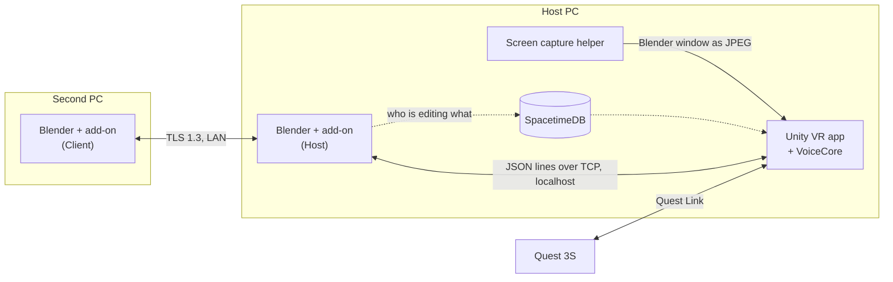

# Spatial Modeling


Edit a real Blender file in VR. A Quest headset shows your scene on a table in your room, and every change you make there is applied by Blender itself as an ordinary Undo step. A second person can edit the same file from Blender on another PC at the same time.

Built at CalHacks 13 by Waaberi Ibrahim, Lee Jae-yeon, Jihyeon and Talia.

## What it's like

You're in the headset, standing at a table you dropped into your living room. Your teammate is at their desk across the room, in plain Blender, working on the same file.

They add a part. It appears on your table a moment later, at its real size. You pick it up, turn it over, and set it down where it actually fits. On their monitor it moves too, because your hands just moved it in their Blender.

You want it exact, so you say "rotate this 90 degrees". It asks "around which axis?" You say "Z", and it's done. You never touched a keyboard.

You both reach for the same part at once. Theirs is refused with "Talia is editing this", so nothing gets clobbered. When you take the headset off, everything you did is in the `.blend`, and Ctrl+Z walks back through it one step at a time.

## How it works

The Blender add-on is the server. It runs inside the host's Blender and is the only thing that changes the file. The VR app and the second Blender send it requests. The add-on checks each one, applies it on Blender's main thread, records an Undo step and sends the change to everyone else. Data from the network is never run as Python.



- **[Blender add-on](blender_addon/spatial_modeling/)** (Python): one add-on with two roles, Host and Client. It uses only the Python that ships with Blender. Objects carry a UUID that survives renames, Undo and save/reopen, so an edit always lands on the object it was meant for.
- **[VR app](app/)** (Unity 6, OpenXR, XR Interaction Toolkit): the room, the table, controller input, the hand menu and a panel showing the live Blender window.
- **[VoiceCore](voice/VoiceCore/)** (C#): offline speech recognition with Vosk, limited to a command grammar. When a command is missing an object, axis or amount, it asks for just that part and keeps the rest.
- **Second PC:** the Client-role add-on connects over TLS 1.3, using the session token as a pre-shared key, so there are no certificates to set up.
- **[SpacetimeDB](spacetime/):** stores who is connected, who is editing which object, and a log of applied edits that survives a Blender restart. Scene data never goes through it.
- **[Wire format](contracts/README.md):** every message has a JSON Schema and an example, and the tests check both.

## Status

- [x] Live scene sync from Blender to VR, on a table you place
- [x] Host command path with native Undo, Redo and Save
- [x] Edit locks, including ones that stop Blender's own tools
- [x] Recovery after reconnects and host restarts
- [x] Encrypted LAN link for the second Blender
- [x] VoiceCore: offline recognition and follow-up questions
- [ ] Editing from VR with the hand menu (PR open)
- [ ] Edit modes and lock warnings in VR (PR open)
- [ ] CAD sketches with constraints (PR open)
- [ ] Voice in the headset
- [ ] Editing from the second PC
- [ ] Blender screen panel in VR (PR open)

Progress is on the [project board](https://github.com/users/waaberi/projects/3).

## Using it

You need:

- a Windows PC with the Meta Horizon Link app
- a Quest 3S, connected with a Link cable or Air Link
- Blender 5.2.2
- optionally, a second PC with Blender 5.2.2 for a second editor

There's no packaged Windows build yet, so for now you run the app from source (see below).

1. Link `blender_addon/spatial_modeling` into Blender's `extensions/user_default/` folder, enable Spatial Modeling under Preferences › Add-ons, and choose Host.
2. Open a `.blend` file, for example [`samples/mechanical/p0_reference_v2.blend`](samples/mechanical/).
3. Start the VR app with the Quest connected through Link.
4. For a second editor: on the host, turn on "Let a Client-role Blender join over the LAN" in the add-on preferences and note the session token. On the other PC, install the add-on, choose Client, and enter the host's address and the token.

## Building from source

On top of the above:

- **VR app:** Unity 6000.6.5f1. Its packages are pinned in `app/Packages/manifest.json`. Before you open `app/` for the first time, fetch the speech libraries and model from Git Bash:
  ```sh
  voice/fetch-vosk.sh
  voice/fetch-model.sh app/Assets/StreamingAssets
  ```
  Then open `app/` and press Play.
- **Tests:** Python 3.13 with `pip install ruff pytest jsonschema`, then `ruff check .` and `pytest tests`. VoiceCore's tests need the .NET 10 SDK: run `voice/fetch-model.sh`, then `dotnet test tests/voice`. CI runs both on every PR.
- **SpacetimeDB (optional):** Node.js and the SpacetimeDB CLI; see [spacetime/README.md](spacetime/README.md). If no SpacetimeDB server is running, the host keeps session state in memory.

The full script is in [docs/demo/DEMO_STEPS.md](docs/demo/DEMO_STEPS.md). Team notes and repo rules are in [CONTRIBUTING.md](CONTRIBUTING.md).

The add-on is licensed GPL-3.0-or-later.
