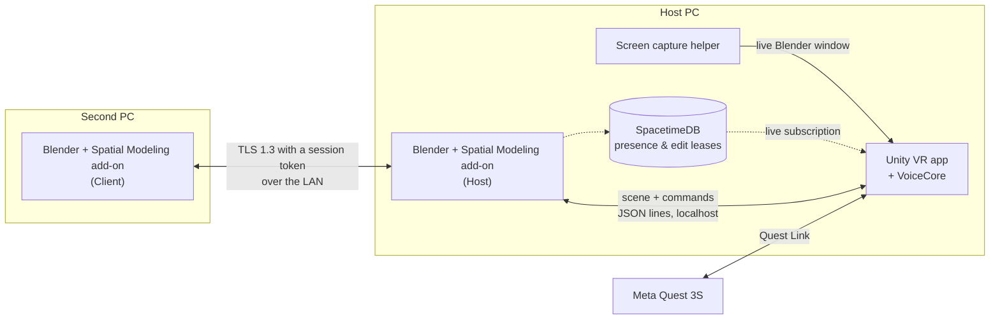

# Spatial Modeling

**Step inside your Blender project.**

Put on a Quest, pull a real `.blend` file onto a virtual worktable, and edit it with your hands and your voice, while a teammate keeps working on the same scene from desktop Blender.

[How it works](#how-it-works) · [Features](#features) · [Status](#status) · [Try it](#try-it) · [Team](#team)

*Built in one weekend at [CalHacks 13](https://calhacks.io).*

---

## Why

3D work is spatial, but we do it through a flat screen, a mouse and a hundred keyboard shortcuts. VR modeling tools exist, but they make you leave your real tools behind: you sculpt in one app, export, import and fix things up in Blender afterwards. And they're single-player.

**Spatial Modeling doesn't replace Blender. It puts you inside it.** Blender stays the source of truth: every edit you make in VR is a real Blender edit, with real Undo, Redo and Save. Anything you change in Blender shows up in the headset straight away. A second person can join from their own Blender, on their own PC, and you both edit the same scene at the same time.

## Features

- 🪑 **A worktable you place.** Pick where the table goes in your room. Your Blender objects sit on it at their true dimensions, and moving the table never moves your model.
- 🔄 **Live, two-way sync.** Move, add or delete something in desktop Blender and it updates in VR at once. Edits made in VR go straight into the native `.blend`.
- 🖐️ **Hand menu with exact numbers.** Grab, move and rotate with the controllers, or type an exact value: +10 mm on X, 90° about Z. Works left- or right-handed.
- 🗣️ **Voice that asks back.** Say *"Rotate this object 90 degrees."* If something is missing, it asks *"Which object?"* and remembers the rest, so you never repeat the whole command. Speech recognition runs offline with Vosk.
- 👥 **Real multiplayer Blender.** A second person joins from their own Blender over the LAN, encrypted with TLS and a shared session token. Both Blenders and the headset stay in agreement.
- 🔒 **Edit ownership, not edit chaos.** Take an object to edit it alone, or share it. If someone else is editing an object, the other person's change is stopped with a clear warning, even when they use Blender's own tools.
- 📐 **CAD sketches with real constraints.** Draw a 100 × 60 mm rectangle, set the width to 120 mm, and the solver keeps the height at 60 mm. Built on [CAD Sketcher](https://github.com/hlorus/CAD_Sketcher).
- 🖥️ **Your Blender screen, in VR.** A panel shows the live Blender window, so you never have to take the headset off. Show or hide it any time.
- ↩️ **Native history.** Every committed edit is one Blender Undo step. Save in VR, reopen in Blender, and it's all there.

## How it works

Blender is the only authority. Every edit, whether it comes from the headset or from the second PC, is a request: the add-on inside Blender checks it, applies it on Blender's main thread, records an Undo step, and sends the result back to everyone.

| Piece | What it does | Built with |
| --- | --- | --- |
| [Blender add-on](blender_addon/spatial_modeling/) | One add-on with two roles. **Host** runs the session, applies every edit and enforces edit ownership. **Client** joins from a second PC and mirrors the scene. | Python, Blender 5.2 API, standard library only |
| [VR app](app/) | The room, the worktable, controllers, hand menu, screen panel and visual feedback. | Unity 6, OpenXR, XR Interaction Toolkit |
| [VoiceCore](voice/VoiceCore/) | Turns speech into commands and remembers what's still missing. Plain C#, tested outside Unity. | C#, Vosk (offline) |
| [Session state](spacetime/) | Who's here, who's editing what, and a log of every applied edit that survives a restart. | SpacetimeDB |
| [Wire format](contracts/README.md) | Every message between the pieces, with JSON Schemas and examples that the tests check. | JSON Schema |

A few decisions we're proud of:

- **No server to install.** The add-on *is* the server, and it needs nothing beyond the Python that ships with Blender.
- **No certificates.** The LAN link uses TLS 1.3 with the session token as a pre-shared key, so joining is just typing the token.
- **Received data is never executed as Python.** Every message is checked against a schema and turned into a known command.
- **Stable IDs.** Objects keep their identity across renames, Undo and save/reopen, so a teammate's edit can't land on the wrong object.

## Status

This is a hackathon build, so here is where each part honestly stands.

| | |
| --- | --- |
| ✅ **Working** | Live scene sync from Blender to VR on a placed table · host command path with native Undo/Redo/Save · edit leases that also block Blender's own tools · recovery from reconnects and host restarts · encrypted LAN link for the second Blender · VoiceCore with offline Vosk recognition |
| 🚧 **Landing now** | Hand menu and native editing from VR · edit modes and ownership warnings in VR · constrained CAD sketches · voice in the headset · second-PC editing · Blender screen panel |

Progress is tracked on the [project board](https://github.com/users/waaberi/projects/3).

## Try it

You'll need Windows, a Meta Quest 3S (or another Quest) with Quest Link, Blender 5.2.2 and Unity 6000.6.5f1.

1. **Install the add-on.** Link or copy `blender_addon/spatial_modeling` into Blender's `extensions/user_default/` folder, enable *Spatial Modeling* under Preferences › Add-ons, and choose **Host**.
2. **Open a scene.** Try [`samples/mechanical/p0_reference_v2.blend`](samples/mechanical/): a 20 mm cube and a 10 × 30 mm cylinder.
3. **Start the VR app.** Open `app/` in Unity 6000.6.5f1 (or run a Windows build), connect the Quest with Quest Link, and press Play.
4. **Add a second editor (optional).** In the host's add-on preferences, turn on *Let a Client-role Blender join over the LAN* and note the session token. On another PC, install the same add-on, choose **Client**, and enter the host's address and that token.

The full walkthrough is in [docs/demo/DEMO_STEPS.md](docs/demo/DEMO_STEPS.md).

## Team

| | Built |
| --- | --- |
| **Waaberi Ibrahim** ([@waaberi](https://github.com/waaberi)) | Blender host add-on, session protocol, edit permissions, VoiceCore |
| **Lee Jae-yeon** ([@yeonlee1212](https://github.com/yeonlee1212)) | Second-PC Client add-on, CAD adapter, screen capture, packaging |
| **Jihyeon** ([@charityjhhong](https://github.com/charityjhhong)) | Unity VR app: room, table, controllers, menus, feedback |
| **Talia** ([@taliamekh](https://github.com/taliamekh)) | Reference models, headset testing, native validation, the demo |

Working on the code? See [CONTRIBUTING.md](CONTRIBUTING.md).

The Blender add-on is licensed GPL-3.0-or-later, as Blender add-ons must be.
