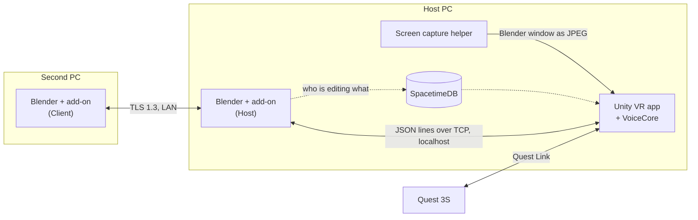

# Spatial Modeling

Edit a real Blender file in VR. A Quest headset shows your scene on a table in your room, and every change you make there is applied by Blender itself as an ordinary Undo step. A second person can edit the same file from Blender on another PC at the same time.

Built at CalHacks 13 by Waaberi Ibrahim, Lee Jae-yeon, Jihyeon and Talia.

## The demo

1. Open a part in Blender on the host PC: a 20 mm cube and a 10 × 30 mm cylinder.
2. Put on the Quest and place the table. The parts appear on it at their real size.
3. Move the cube in desktop Blender. It moves in the headset too.
4. In VR, move the cube 10 mm along X and turn it 90° about Z. Blender's fields show the new values, and Ctrl+Z in Blender undoes it.
5. Sketch a 100 × 60 mm rectangle and change its width to 120 mm. The constraint solver keeps it 60 mm tall.
6. With nothing selected, say "rotate this object 90 degrees". The app asks which object, you point at one, and the command finishes.
7. A teammate edits a different object from their own Blender. If you both grab the same object, the second edit is refused with a message saying who has it.

## How it works

The Blender add-on is the server. It runs inside the host's Blender and is the only thing that changes the file. The VR app and the second Blender send it requests. The add-on checks each one, applies it on Blender's main thread, records an Undo step and sends the change to everyone else. Data from the network is never run as Python.

- **[Blender add-on](blender_addon/spatial_modeling/)** (Python): one add-on with two roles, Host and Client. It uses only the Python that ships with Blender. Objects carry a UUID that survives renames, Undo and save/reopen, so an edit always lands on the object it was meant for.
- **[VR app](app/)** (Unity 6, OpenXR, XR Interaction Toolkit): the room, the table, controller input, the hand menu and a panel showing the live Blender window.
- **[VoiceCore](voice/VoiceCore/)** (C#): offline speech recognition with Vosk, limited to a command grammar. When a command is missing an object, axis or amount, it asks for just that part and keeps the rest.
- **Second PC:** the Client-role add-on connects over TLS 1.3, using the session token as a pre-shared key, so there are no certificates to set up.
- **[SpacetimeDB](spacetime/):** stores who is connected, who is editing which object, and a log of applied edits that survives a Blender restart. Scene data never goes through it.
- **[Wire format](contracts/README.md):** every message has a JSON Schema and an example, and the tests check both.

## Status

Working on `main`: live scene sync from Blender to VR, the host command path with Undo/Redo/Save, edit locks that also stop Blender's own tools, recovery after reconnects and host restarts, the encrypted link for the second Blender, and VoiceCore.

In open PRs: editing from VR with the hand menu, edit modes and lock warnings in VR, CAD sketches, voice in the headset, editing from the second PC, and the Blender screen panel.

Progress is on the [project board](https://github.com/users/waaberi/projects/3).

## Running it

You need Windows, a Quest 3S with Quest Link, Blender 5.2.2 and Unity 6000.6.5f1.

1. Link `blender_addon/spatial_modeling` into Blender's `extensions/user_default/` folder, enable Spatial Modeling under Preferences › Add-ons, and choose Host.
2. Open [`samples/mechanical/p0_reference_v2.blend`](samples/mechanical/).
3. Open `app/` in Unity, connect the Quest with Quest Link, and press Play.
4. For a second editor: on the host, turn on "Let a Client-role Blender join over the LAN" in the add-on preferences and note the session token. On the other PC, install the add-on, choose Client, and enter the host's address and the token.

The full script is in [docs/demo/DEMO_STEPS.md](docs/demo/DEMO_STEPS.md). Team notes and repo rules are in [CONTRIBUTING.md](CONTRIBUTING.md).

The add-on is licensed GPL-3.0-or-later.
