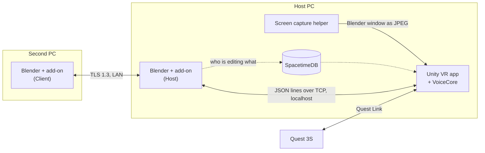

# Spatial Modeling


Spatial Modeling lets you edit a real Blender project in VR, together with someone working in desktop Blender.

Put on a Quest and your scene appears on a table in your room, at real size. Grab objects, move them, rotate them and type exact values. Give it voice commands. Every edit happens in Blender itself, so the file, Undo, Redo and Save all work as usual. A teammate on another PC can open the same session in their own Blender and edit alongside you.

Built at CalHacks 13 by Waaberi Ibrahim, Lee Jae-yeon, Jihyeon and Talia.

## Features

- **Your Blender scene in VR.** Place a worktable anywhere in your room. Objects sit on it at their true dimensions, and changes made in Blender show up in the headset right away.
- **Hands-on editing.** Move, rotate, scale, add and delete objects with the controllers. A hand menu takes exact numbers when you need precision, and it works for left- and right-handed users.
- **Voice commands.** Say "rotate this 90 degrees". If something is missing, it asks a short question, such as which axis, and then finishes the command. Recognition runs offline.
- **Two people, one scene.** A second person joins from Blender on their own PC over an encrypted LAN connection. Everyone sees every change.
- **No conflicts.** When someone is editing an object, other edits to it are blocked with a message saying who has it. This covers Blender's own tools too.
- **CAD sketches.** Draw sketches with real dimensions and constraints. Change a dimension and the solver updates the shape. Built on CAD Sketcher.
- **Blender on a screen in VR.** A panel shows the live Blender window, so you don't need to take the headset off.
- **Native Blender history.** Each edit is one Undo step. Save from VR, reopen in Blender, and everything is there.

## How it works

The add-on runs inside Blender on the host PC and acts as the server. The VR app and the second Blender send it edit requests. The add-on checks each request, applies it in Blender, records an Undo step and sends the result to everyone. Blender stays the single source of truth.



- **[Blender add-on](blender_addon/spatial_modeling/)** (Python): one add-on with two roles, Host and Client. It needs nothing beyond the Python that ships with Blender. Every object gets a stable ID that survives renames, Undo and save/reopen.
- **[VR app](app/)** (Unity 6, OpenXR, XR Interaction Toolkit): the room, the table, controller input, the hand menu and the Blender screen panel.
- **[VoiceCore](voice/VoiceCore/)** (C#): offline speech recognition with Vosk and a command grammar. It remembers the parts of a command it already has and asks only for what's missing.
- **Secure LAN link:** the second Blender connects over TLS 1.3 using the session token as a pre-shared key. There are no certificates to set up.
- **[SpacetimeDB](spacetime/):** tracks who is connected, who is editing which object, and a log of applied edits that survives a restart.
- **[Wire format](contracts/README.md):** every message has a JSON Schema and an example, and CI checks both.

## Using it

You need:

- a Windows PC with the Meta Horizon Link app
- a Quest 3S, connected with a Link cable or Air Link
- Blender 5.2.2
- optionally, a second PC with Blender 5.2.2 for a second editor

Then:

1. Link `blender_addon/spatial_modeling` into Blender's `extensions/user_default/` folder, enable Spatial Modeling under Preferences › Add-ons, and choose Host.
2. Open a `.blend` file, for example [`samples/mechanical/p0_reference_v2.blend`](samples/mechanical/).
3. Connect the Quest through Link and start the VR app.
4. To add a second editor, turn on "Let a Client-role Blender join over the LAN" in the host's add-on preferences and note the session token. On the other PC, install the add-on, choose Client, and enter the host's address and the token.

## Building from source

- **VR app:** Unity 6000.6.5f1. Packages are pinned in `app/Packages/manifest.json`. Before opening `app/` for the first time, fetch the speech libraries and model from Git Bash:
  ```sh
  voice/fetch-vosk.sh
  voice/fetch-model.sh app/Assets/StreamingAssets
  ```
  Then open `app/` in Unity and press Play, or build for Windows.
- **Tests:** Python 3.13 with `pip install ruff pytest jsonschema`, then `ruff check .` and `pytest tests`. VoiceCore's tests need the .NET 10 SDK: run `voice/fetch-model.sh`, then `dotnet test tests/voice`. CI runs both on every PR.
- **SpacetimeDB (optional):** Node.js and the SpacetimeDB CLI. See [spacetime/README.md](spacetime/README.md). Without it, the host keeps session state in memory.

Team notes and repo rules are in [CONTRIBUTING.md](CONTRIBUTING.md). The demo script is in [docs/demo/DEMO_STEPS.md](docs/demo/DEMO_STEPS.md).

The add-on is licensed GPL-3.0-or-later.
